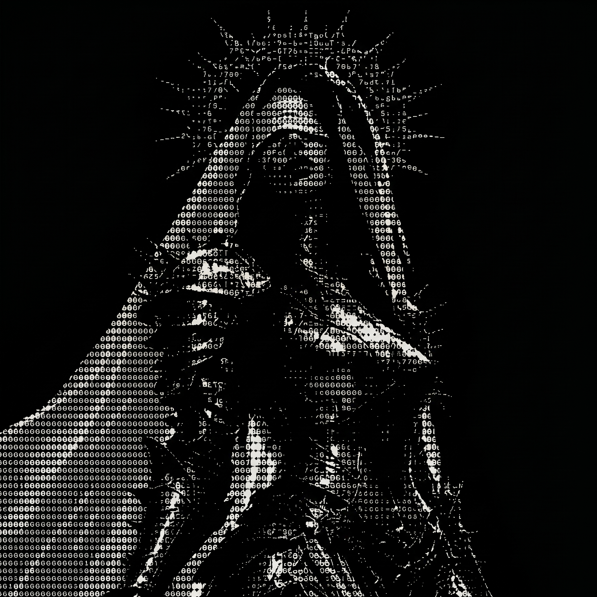

<div align="center">



# Minerva & AI Agents Ecosystem

**Hub Unificado de Orquestração Multi-Agente, Biblioteca de 368 Skills, Servidores MCP & Cofre de Conhecimento para Obsidian.**

🌐 **[Português](README.md)** | **[English](README.en.md)**

[](#-instalação-rápida-cross-platform)
[](skills/)
[](vault/Agentes/)
[](LICENSE)

</div>

---

## Visão Geral

Este repositório centraliza toda a infraestrutura agêntica de desenvolvimento, integrando inteligências artificiais líderes de mercado (**Antigravity / Gemini CLI**, **Claude Code**, **Codex**, **Hermes Agent** e **Maestri Canvas**) sob uma arquitetura coesa e sincronizada.

```text
agents/                                <-- Raiz do Repositório
│
├── 📁 assets/minerva/                 <-- Avatares oficiais da Minerva
├── 📁 skills/                         <-- 368 Skills de desenvolvimento prontas
├── 📁 mcp_config.json                 <-- Configuração unificada de servidores MCP
├── 📁 hermes/skins/                   <-- 16 temas customizados YAML
├── 📁 toolkits/                       <-- Vibe Coding Toolkit & prompts avançados
├── 📁 vault/Agentes/                  <-- Cofre completo do Obsidian
│   ├── 📁 Workspace/                  <-- Arquitetura Minerva, Conselho & Team CODES
│   ├── 📁 Skills/                     <-- 368 pastas com documentação em PT-BR
│   ├── 📁 MCP/                        <-- Manuais (ai-memory, rea, agent-desktop, magicpath)
│   ├── 📁 MODS/                       <-- Skins do Hermes e Toolkits
│   ├── 📁 Frameworks/                 <-- Bibliotecas de agentes (alethe, claude-cookbooks, etc.)
│   ├── 📁 Apps/                       <-- Aplicações locais com aceleração GPU/CPU
│   ├── 📁 Opcionais/                  <-- Ferramentas de apoio (painel-agents)
│   └── 📄 _Hub de Skills & MCPs.md    <-- Dashboard de navegação do cofre
│
├── 📄 setup.bat                       <-- Instalador 1-click para Windows (CMD)
├── 📄 setup.ps1                       <-- Instalador 1-click para Windows (PowerShell)
├── 📄 setup.sh                        <-- Instalador 1-click para Linux e macOS
└── 📄 sync_obsidian.mjs               <-- Script de sincronização contínua do cofre
```

---

## Instalação Rápida (Cross-Platform)

Você pode clonar este repositório em qualquer computador (**Windows, Linux ou macOS**) e rodar um único comando para deixar seu ambiente 100% pronto.

### No Windows:

Abra o prompt de comando (ou PowerShell) e execute:
```cmd
git clone https://github.com/lk-feitosa/minerva-workspace.git S:\DEV\agents
cd S:\DEV\agents
setup.bat
```
*(Ou no PowerShell: `.\setup.ps1`)*

O script criará automaticamente os NTFS Junctions vinculando o repositório aos caminhos padrão dos agentes (`~/.agents`, `~/.codex/skills` e `%LOCALAPPDATA%\hermes\skins`).

---

### No Linux ou macOS:

Abra o terminal e execute:
```bash
git clone https://github.com/lk-feitosa/minerva-workspace.git ~/DEV/agents
cd ~/DEV/agents
chmod +x setup.sh
./setup.sh
```

O script criará automaticamente os links simbólicos necessários (`~/.agents`, `~/.codex/skills`, `~/.hermes/skins`).

---

## Como Abrir o Cofre no Obsidian

1. Abra o aplicativo **Obsidian**.
2. Clique em **"Open folder as vault"** (Abrir pasta como cofre).
3. Selecione o diretório:
   * **No Windows:** `S:\DEV\agents\vault\Agentes` (ou `C:\Users\SEU_USUARIO\.agents\vault\Agentes`)
   * **No Linux/Mac:** `~/DEV/agents/vault/Agentes` (ou `~/.agents/vault/Agentes`)
4. Pronto! O cofre abrirá com:
   * **Excalidraw** pré-configurado em Dark Mode.
   * Plugins essenciais ativos.
   * Dashboard interativo em `_Hub de Skills & MCPs.md`.
   * Nota mestra em `Workspace/Orquestração de Projetos - Minerva & Conselho.md`.

---

## Sincronização e Manutenção

Sempre que adicionar ou atualizar skills ou ferramentas, execute o script de sincronização:

```bash
node sync_obsidian.mjs
```

Ele regenera o índice hierárquico, traduz as visões gerais para português e atualiza os contadores no Dashboard do Obsidian.

---

## Arquitetura de Orquestração: Minerva & Team CODES

Consulte a documentação completa no Obsidian em:  
👉 **`Workspace/Orquestração de Projetos - Minerva & Conselho.md`**

* **Minerva:** Orquestrador Central com supervisão autônoma de múltiplos terminais no Maestri (Zero Human-in-the-Loop).
* **Conselho dos 5:** Contrário, Primeiros Princípios, Expansionista, Forasteiro e Executor.
* **Team CODES:** Pipeline de engenharia de 12 papéis (Spec, Plan, Dev, UI, Backend, Tests, Review, Ship, etc.).
* **Branches no Git:** Isolamento concorrente em sub-branches (`agent/ui`, `agent/backend`) com commits padronizados por emojis.

---

## Configuração Automática via Agente de IA (Prompt de Setup)

Se você utiliza um assistente de IA no seu terminal ou editor (**Antigravity**, **Claude Code**, **Codex**, **Cursor** ou **Aider**) e prefere que o próprio agente configure o seu sistema operacional para adotar esta arquitetura global, basta clonar este repositório e colar o prompt abaixo diretamente no seu agente:

```text
Você é o meu assistente de IA configurando este computador.
Acabei de clonar o ecossistema Minerva & Agents (minerva-workspace) nesta máquina.
Por favor, configure o meu ambiente para operar nesta arquitetura global unificada:

1. Identifique o meu Sistema Operacional (Windows / Linux / macOS) e a pasta onde este repositório foi clonado.
2. Em vez de utilizar diretórios individuais e isolados, configure o apontamento global criando os links necessários:
   - No Windows: Crie os NTFS Junctions vinculando:
     * %USERPROFILE%\.agents -> [caminho_deste_repositorio]
     * %USERPROFILE%\.codex\skills -> [caminho_deste_repositorio]\skills
     * %LOCALAPPDATA%\hermes\skins -> [caminho_deste_repositorio]\hermes\skins
   - No Linux ou macOS: Crie os links simbólicos (ln -s):
     * ~/.agents -> [caminho_deste_repositorio]
     * ~/.codex/skills -> [caminho_deste_repositorio]/skills
     * ~/.hermes/skins -> [caminho_deste_repositorio]/hermes/skins
3. Valide se Node.js, Python 3 e Git estão presentes no PATH.
4. Confirme que o cofre do Obsidian está localizado na pasta 'vault/Agentes' deste repositório e indique como abri-lo.
5. Apresente um resumo claro com o status de cada item configurado.
```

---

## Créditos, Atribuições & Licenças

Este projeto é um ecossistema integrador. Todos os direitos de propriedade intelectual, marcas e códigos de terceiros pertencem aos seus respectivos criadores originais (Google, Anthropic, Vercel Labs, Kanbn, Fabio Akita, Addy Osmani, Matt Pocock, Affaan M, Composio, etc.).

Consulte a lista completa com os links para os repositórios originais em:  
👉 **[CREDITS.pt-br.md](CREDITS.pt-br.md)** *(English version: [CREDITS.md](CREDITS.md))*


