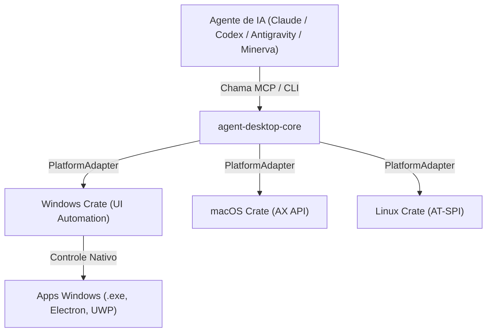

---
tags:
  - ai/mcp
  - mcp-server
  - computer-use
  - vercel-labs
  - desktop-automation
name: "agent-desktop"
github: "https://github.com/vercel-labs/agent-desktop"
updated_at: "2026-11-12T18:45:00.000Z"
---

# 🖥️ Servidor MCP: Agent Desktop (Computer Use para Agentes de IA)

> [!INFO] **Visão Geral Oficial**
> **Repositório Oficial:** [https://github.com/vercel-labs/agent-desktop](https://github.com/vercel-labs/agent-desktop)  
> **Mantenedor:** Vercel Labs  
> **Identificador MCP:** `agent-desktop`  
> **Tipo de Conexão:** CLI Local (Stdio via binário nativo ou `npx agent-desktop@latest mcp`)  
> **Plataformas Suportadas:** Windows 10/11 (UI Automation), macOS 13+ (AX API), Linux (AT-SPI)

---

## 💡 O que é o Agent Desktop? (Resumo Oficial Vercel Labs)

O **agent-desktop** fornece **Computer Use real para agentes de IA** sem a necessidade de capturas de tela contínuas ou reconhecimento visual por pixels (*pixel matching*).

Em vez de enviar imagens pesadas para um modelo de visão, o agent-desktop lê diretamente a **Árvore de Acessibilidade nativa do Sistema Operacional** (UI Automation no Windows) e a retorna como uma estrutura JSON hierárquica. Cada elemento interativo na tela (botões, campos de texto, abas, menus) recebe um identificador único e estável chamado **`ref`** (ex.: `@s8f3k2p9:e8`).

### O Ciclo de Operação do Agente:
1. **Observação (`snapshot`):** O agente tira um snapshot da aplicação alvo e recebe a árvore de acessibilidade com os `refs`.
2. **Ação (`click`, `type`, `focus`):** O agente age diretamente sobre o `ref` desejado.
3. **Verificação (`snapshot`):** O agente re-inspeciona a interface para confirmar a mudança de estado e planejar o próximo passo.

> [!NOTE] O loop de controle reside no seu agente; o agent-desktop não embute nenhum modelo de IA internamente, funcionando puramente como a camada de controle do sistema operacional.

---

## ⚙️ Arquitetura e Como Funciona



* **Headless por Padrão:** As ações nos refs utilizam chamadas da API de acessibilidade sem mover fisicamente o cursor do mouse e sem roubar o foco da janela ativa (a menos que a flag `--headed` seja especificada).
* **Escopo dos Refs:** Os refs pertencem exclusivamente ao snapshot em que foram gerados. Se a interface mudar ou a tela for atualizada, o comando retornará `STALE_REF`, exigindo um novo snapshot.
* **Atenção no PowerShell (Windows):** Sempre envolva o ref entre aspas simples (ex.: `'@s8f3k2p9:e8'`), pois o caractere `@` solto é interpretado pelo PowerShell como operador de *splatting*.

---

## 🚀 Instalação e Diagnóstico

### 1. Instalação Global
```bash
npm install -g agent-desktop
# ou execute sem instalar via npx:
npx -y agent-desktop@latest status
```

### 2. Verificação de Saúde e Permissões
```bash
agent-desktop status                # Exibe plataforma, permissões e superfícies ativas
agent-desktop permissions           # Verifica permissões do sistema
agent-desktop permissions --guide   # Guia interativo caso falte permissão de acessibilidade
```

---

## 🛠️ Como Usar no Projeto (Passo a Passo Prático)

### 1. Inspecionar uma Janela Ativa
```bash
# Inspeciona os elementos interativos do aplicativo (ex: Bloco de Notas ou VS Code):
agent-desktop snapshot --app "Notepad" -i

# Para aplicativos densos, gerar esqueleto compacto:
agent-desktop snapshot --skeleton --app "Slack" -i --compact
```

### 2. Executar Ações em Elementos
```bash
# Clicar em um botão identificado no snapshot:
agent-desktop click '@s8f3k2p9:e8'

# Digitar texto em um campo de formulário:
agent-desktop type '@s8f3k2p9:e12' "Minha mensagem automatizada"

# Focar em uma janela específica:
agent-desktop focus-window --window-id 12480
```

### 3. Entrada Segura de Credenciais (via STDIN)
Para evitar que senhas e chaves fiquem salvas no histórico do bash:
```bash
echo "MinhaSenhaSuperSegura" | agent-desktop type '@s8f3k2p9:e15' --stdin
```

---

## 📋 Catálogo Completo de Comandos (57 Comandos Operacionais)

O agent-desktop possui 57 comandos operacionais categorizados:

| Categoria | Comandos Disponíveis | Finalidade Principal |
| :--- | :--- | :--- |
| **🔍 Observação** | `snapshot`, `find`, `get`, `is`, `screenshot`, `list-surfaces` | Mapear árvore de elementos, buscar por texto/role, capturar prints de tela e inspecionar propriedades. |
| **🎯 Ação em Refs** | `click`, `double-click`, `triple-click`, `right-click`, `type`, `set-value`, `clear`, `focus`, `select`, `toggle`, `check`, `uncheck`, `expand`, `collapse`, `scroll`, `scroll-to` | Disparar ações atômicas em elementos interativos identificados pelo snapshot. |
| **🖱️ Teclado & Mouse Físicos** | `press`, `hover`, `drag`, `mouse-move`, `mouse-click`, `mouse-wheel`, `key-down`, `key-up`, `mouse-down`, `mouse-up` | Simular entradas físicas de periféricos na tela quando necessário. |
| **🪟 Apps & Janelas** | `launch`, `close-app`, `list-apps`, `list-windows`, `list-displays`, `focus-window`, `resize-window`, `move-window`, `minimize`, `maximize`, `restore`, `open-system-surface` | Gerenciar o ciclo de vida de processos, focar janelas e controlar múltiplos monitores. |
| **🔔 Notificações** | `list-notifications`, `dismiss-notification`, `dismiss-all-notifications`, `notification-action` | Ler e interagir com notificações do sistema operacional. |
| **📋 Área de Transferência** | `clipboard-get`, `clipboard-set`, `clipboard-clear` | Ler, gravar ou limpar dados do clipboard do sistema. |
| **⏱️ Sincronização & Espera** | `wait` | Aguardar condições assíncronas de interface antes da próxima etapa. |
| **🎬 Sessões & Rastreamento** | `session`, `trace`, `cursor-overlay` | Gravar rastreabilidade de ações e depuração visual de passos executados. |
| **⚙️ Sistema & Diagnóstico** | `status`, `permissions`, `version`, `batch`, `skills` | Verificar permissões, consultar manuais embutidos e rodar lotes de comandos. |

---

## 🔌 Configuração Oficial no MCP (Model Context Protocol)

O comando `agent-desktop mcp` expõe todos os comandos como ferramentas MCP nativas (`desktop_snapshot`, `desktop_click`, `desktop_type`, etc.) via stdio.

### Configuração em `mcpServers` (Claude Code / Codex / Antigravity / Cursor):
```json
{
  "mcpServers": {
    "agent-desktop": {
      "command": "cmd.exe",
      "args": [
        "/d",
        "/c",
        "npx",
        "-y",
        "agent-desktop@latest",
        "mcp"
      ]
    }
  }
}
```
*(No Linux ou macOS, substitua `cmd.exe /d /c npx` por `"command": "npx"` e `"args": ["-y", "agent-desktop@latest", "mcp"]`)*.

---

## 📖 README Oficial do Repositório (Vercel Labs Upstream)

<details>
<summary><strong>📄 Clique aqui para expandir o README oficial original (em inglês)</strong></summary>

```markdown
# agent-desktop

Computer use for AI agents: see and operate desktop apps on macOS, Windows, and Linux through the OS accessibility tree.

agent-desktop gives an AI agent computer use without screenshots or pixel matching. It reads the accessibility tree of a desktop app and returns it as JSON, with a ref for every element the agent can act on. The agent clicks or types on a ref, reads the UI again to check the result, and repeats. The loop lives in your agent; agent-desktop has no model inside. It ships as a CLI and a C library.

Snapshots, clipboard reads, screenshots, command output, and debug artifacts can contain private desktop content. Keep them out of public logs and uploads.

## Install

```bash
npm install -g agent-desktop
agent-desktop status                # platform, permissions, supported surfaces
agent-desktop permissions --guide   # macOS: walks you through the Accessibility grant
```

Bun, Yarn and pnpm can install the same package. It includes native binaries and platform helpers for x64 and ARM64.
For direct execution without a JavaScript launcher, download the matching native archive from GitHub Releases.

## Quick start

```bash
agent-desktop snapshot --app Finder -i      # interactive elements, each with a ref
agent-desktop click @s8f3k2p9:e8            # act on a ref from that snapshot
agent-desktop snapshot --app Finder -i      # observe again to verify
```

Each command prints one JSON envelope:
- Refs belong to their snapshot.
- Headless by default.
- Post-action waits observe the ref's original process.
- PowerShell: quote every ref ('@s8f3k2p9:e8').

## MCP

`agent-desktop mcp` serves every command as an MCP tool over stdio. A tool is named after its command (`desktop_snapshot`, `desktop_click`, `desktop_session_start`), takes that command's arguments, and returns its JSON envelope:

```json
{ "mcpServers": { "agent-desktop": { "command": "agent-desktop", "args": ["mcp"] } } }
```

## Documentation
- Website & Guides: https://agent-browser.dev/desktop
- License: Apache-2.0
```

</details>
