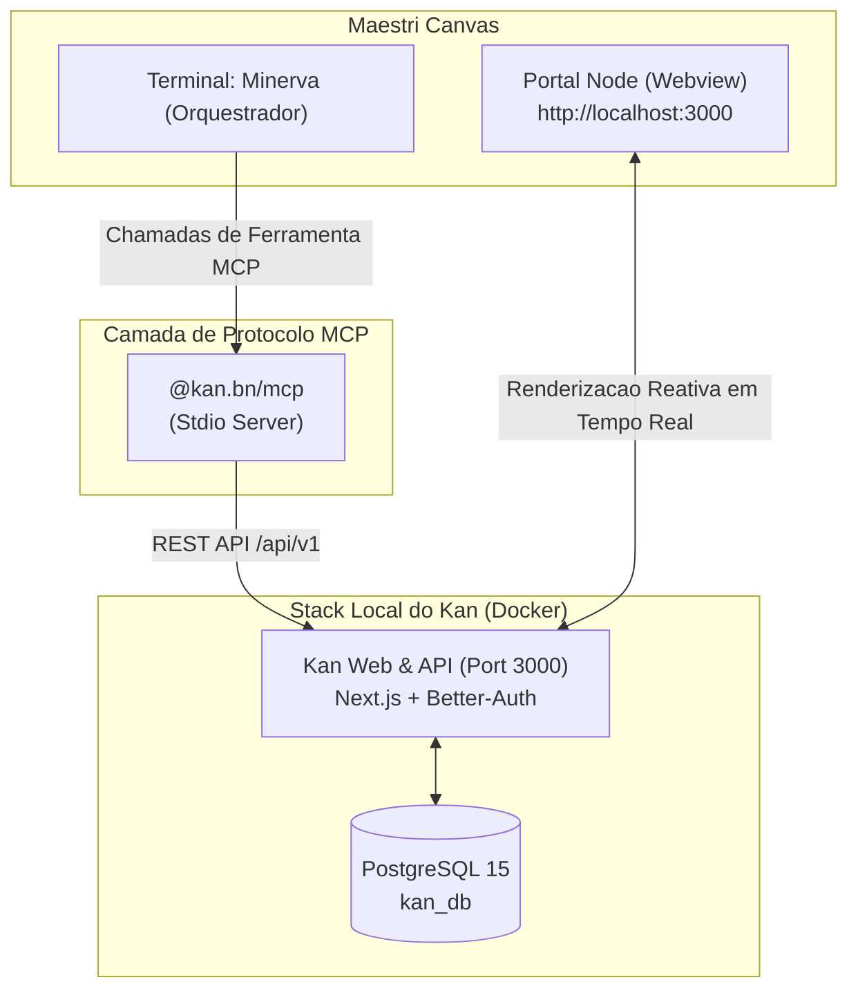

---
tags:
  - ai/opcionais
  - kanban
  - mcp
  - maestri
  - orquestracao
  - produtividade
categoria: Opcionais
nome: kan-kanban
autor: lk-feitosa
local: "S:\\DEV\\frameworks\\kan"
updated_at: "2026-11-08T02:45:00-03:00"
---

# Kan Kanban & MCP — Orquestracao Visual no Maestri Canvas

> [!NOTE] **Kanban Aberto com Suporte Nativo a Model Context Protocol (MCP)**  
> O [Kan](https://github.com/kanbn/kan) é uma plataforma Kanban moderna, open-source e auto-hospedável com suporte completo ao protocolo MCP (`@kan.bn/mcp`). Ele permite que o agente orquestrador (**Minerva**) e subagentes criem, listem, organizem e movam tarefas programaticamente, enquanto você acompanha tudo visualmente no canvas do **Maestri** através de um nó de portal web.



---

## Por que integrar o Kan ao Maestri?

1. **Acompanhamento Visual Passivo:**
   * Em vez de ler saídas textuais complexas no terminal, os cartões de progresso aparecem e se movem em colunas (*Backlog*, *Em Progresso*, *Revisão*, *Concluído*) no próprio quadro Kanban ao lado do terminal.
2. **Controle Total via IA (MCP First-Class):**
   * O pacote `@kan.bn/mcp` expõe ferramentas granulares para manipular workspaces, boards, listas, cards, checklists, membros e etiquetas.
3. **Persistência Local e Privada:**
   * Todos os dados residem no banco de dados PostgreSQL local gerenciado pelo Docker, sem dependência de SaaS de terceiros ou planos pagos.

---

## Isolamento Contextual por Projeto (Por que nao e Global?)

Um erro comum em fluxos de IA é misturar tarefas de diferentes clientes e sistemas em um único quadro global. No ecossistema Minerva:

* **Servidor Centralizado:** A stack do Docker roda uma única vez no sistema na porta `3000` (economia de CPU/RAM).
* **Quadros (Boards) Isolados:** Cada repositório Git ou pasta de trabalho mapeia para o seu **próprio quadro dedicado** no Kan.
* **Automação via CLI:** O comando `kanban` no terminal descobre a raiz do projeto e direciona a visualização e os cartões automaticamente para aquele projeto.
* **Orquestração Contextual com Minerva:** Ao ser acionada em uma pasta, Minerva identifica o projeto atual e restringe todas as chamadas de ferramentas MCP (`create_card`, `move_card`, etc.) ao quadro daquele projeto.

---

## Comando CLI Integrado: `kanban`

Um utilitário CLI rápido está disponível no PATH (`~/.local/bin/kanban` e `kanban.cmd`):

| Comando | Descrição |
| :--- | :--- |
| `kanban` | Detecta a pasta/projeto atual e abre o quadro Kanban no navegador. |
| `kanban portal` (ou `kanban -p`) | Cria diretamente um nó de Portal Web no **Maestri Canvas** apontando para o Kanban. |
| `kanban status` | Verifica se o servidor Kan (`http://localhost:3000`) está online ou offline. |
| `kanban start` | Inicializa os contêineres do Kan em background via Docker Compose. |
| `kanban stop` | Pausa os contêineres do Kan para liberar recursos. |

---

## Estrutura do Pacote e Arquivos

* **Repositório Local:** [`S:\DEV\frameworks\kan`](file:///S:/DEV/frameworks/kan)
* **Configuração Docker:** [`docker-compose.yml`](file:///S:/DEV/frameworks/kan/docker-compose.yml)
* **Ambiente Local:** [`.env`](file:///S:/DEV/frameworks/kan/.env)
* **Servidor MCP:** `@kan.bn/mcp` (instalável via `npx -y @kan.bn/mcp`)
* **Configuração Global MCP:** [`S:\DEV\agents\mcp_config.json`](file:///S:/DEV/agents/mcp_config.json)

---

## Ferramentas Disponíveis no Servidor MCP

O `@kan.bn/mcp` fornece as seguintes ferramentas para Minerva e seus agentes:

* **Workspaces:**
  * `list_workspaces` — lista os workspaces aos quais o usuário tem acesso.
  * `get_workspace` — detalhes de um workspace específico.
* **Boards:**
  * `list_boards` — lista todos os quadros de um workspace.
  * `get_board` — obtém detalhes e listas de um quadro.
  * `create_board` — cria um novo quadro de projeto.
  * `update_board` / `delete_board` — atualiza ou remove quadros.
* **Lists (Colunas):**
  * `list_lists` — recupera as listas/colunas existentes.
  * `create_list` — cria uma coluna (ex.: "To Do", "In Progress", "Done").
  * `update_list` / `move_list` / `delete_list` — reorganiza as colunas.
* **Cards (Cartões / Tarefas):**
  * `list_cards` — recupera os cartões de uma lista ou quadro.
  * `get_card` — lê detalhes, descrição e histórico de uma tarefa.
  * `create_card` — adiciona uma tarefa detalhada à lista indicada.
  * `update_card` — modifica título, descrição ou data de entrega.
  * `move_card` — move um cartão entre colunas (ex.: de "In Progress" para "Done").
  * `delete_card` — arquiva ou apaga cartões.
* **Checklists & Labels:**
  * `create_checklist`, `update_checklist_item`, `delete_checklist`.
  * `create_label`, `attach_label_to_card`, `detach_label_from_card`.

---

## Modo Padrão Recomendado: Kan.bn Nuvem (`https://kan.bn`)

No ecossistema Minerva & Maestri, o modo padrão e oficial é a **Nuvem Oficial Kan.bn** (`https://kan.bn`). 

### Por que a Nuvem Oficial é o Padrão do Workspace?
* **Zero Overhead Local:** Não gasta memória RAM ou processamento rodando instâncias de Docker, contêiner PostgreSQL ou servidor local Next.js em segundo plano.
* **Interface Oficial Completa:** Drag-and-drop nativo, edição rica em tempo real, labels, checklists com cálculo de progresso e histórico de atividades.
* **Isolamento de Workspaces:** Cada projeto possui seu próprio quadro dedicado sob sua conta/organização (ex: `LK TTS Dev`).
* **Sessão Persistente:** O login é feito **apenas uma única vez** no primeiro acesso ao Portal no Maestri.

---

## Guia de Uso: Kan.bn Nuvem no Maestri Canvas

### Passo 1: Criar o Quadro do Projeto no Kan.bn
1. Acesse [kan.bn](https://kan.bn) no seu navegador.
2. Na sua organização (ex: **`LK TTS Dev`**), crie um novo quadro para o projeto (ex.: `test-maestri` ou `meu-projeto`).
3. Copie a URL direta do quadro na barra de endereços (ex.: `https://kan.bn/lk-tts-dev/meu-projeto`).

### Passo 2: Abrir o Portal Dedicado no Maestri Canvas
No terminal da Minerva ou no terminal do Canvas, execute o comando de criação do Portal com o título `"Kanban"`:
```bash
maestri portal create "https://kan.bn/lk-tts-dev/meu-projeto" "Kanban"
```
> O Maestri criará um nó de navegador dedicado (Chromium embutido) diretamente na sua área de trabalho visual, ao lado dos seus terminais de agentes e separado do Painel de Agentes (`:3333`).

### Passo 3: Login no Primeiro Acesso (Feito Apenas Uma Vez)
1. Na primeira vez em que a janela do portal abrir no Maestri Canvas, ela exibirá a tela de login do Kan.bn.
2. Digite seu e-mail e senha da conta Kan.bn.
3. **Pronto! A sessão fica salva nos cookies locais do Maestri.** 
4. Nas próximas vezes em que você abrir o Maestri, reiniciar o PC ou trocar de aba, o quadro já abrirá logado e pronto para o trabalho, sem pedir senha novamente.

### Passo 4: Integração Automatizada via MCP `@kan.bn/mcp` (Opcional para a Minerva)
Para que a Minerva e os agentes possam criar cartões, listar checklists e mover tarefas programaticamente pelo MCP `kan`:
1. No [kan.bn](https://kan.bn), acesse **User Settings** (Configurações do Usuário) > **API Tokens**.
2. Gere um novo token de acesso pessoal.
3. Configure o arquivo [`mcp_config.json`](file:///S:/DEV/agents/mcp_config.json):
```json
"kan": {
  "command": "npx",
  "args": [
    "-y",
    "@kan.bn/mcp"
  ],
  "env": {
    "KAN_BASE_URL": "https://kan.bn",
    "KAN_API_TOKEN": "seu_token_aqui"
  }
}
```

---

## Modo Alternativo Offline: Kan Localhost (`localhost:3000` via Docker)

Caso precise desenvolver em um ambiente 100% desconectado da internet:

1. Inicie o **Docker Desktop** no Windows.
2. Navegue até o repositório oficial clonado em `S:\DEV\frameworks\kan` e suba os contêineres:
   ```powershell
   cd S:\DEV\frameworks\kan
   docker compose up -d
   ```
3. Abra o portal apontando para a porta local:
   ```bash
   maestri portal create http://localhost:3000 "Kanban"
   ```
4. Na primeira abertura, conclua o cadastro de administrador local offline.
* Ao disparar tarefas paralelas para outros agentes, Minerva criará e moverá os cartões visualmente no quadro em tempo real.
