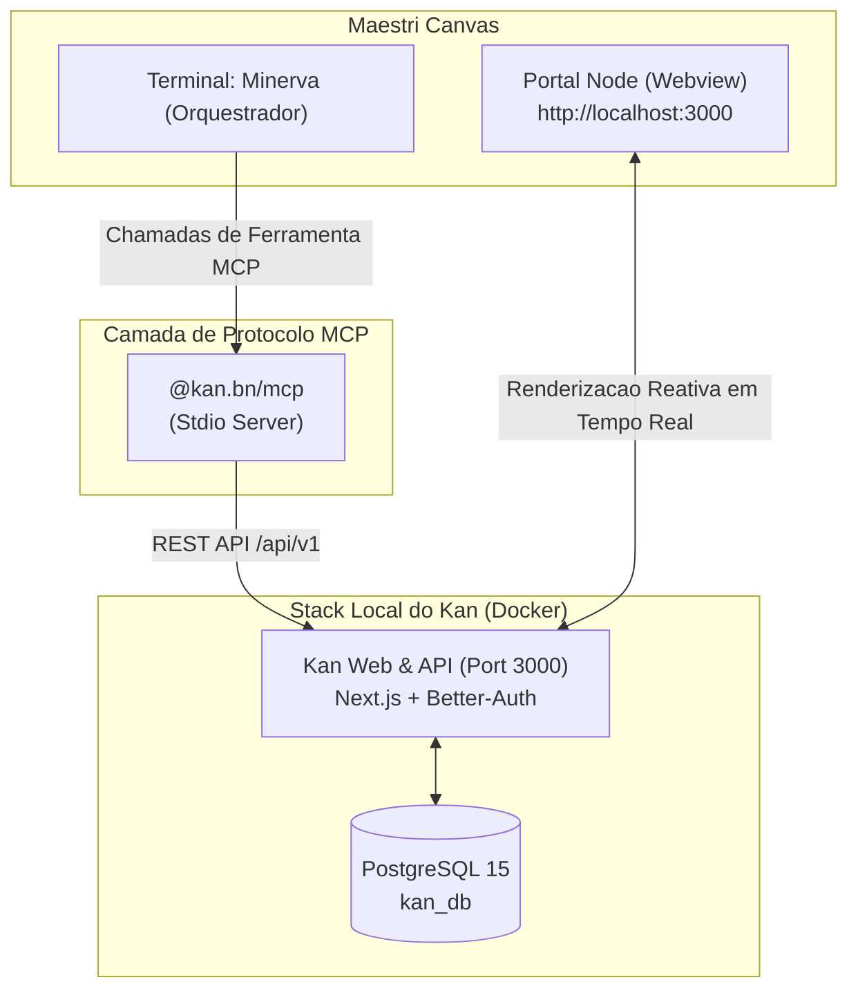

---
tags:
  - ai/opcionais
  - kanban
  - mcp
  - maestri
  - orquestracao
  - produtividade
categoria: Opcionais
nome: kan-kanban
autor: lk-feitosa
local: "S:\\DEV\\frameworks\\kan"
updated_at: "2026-11-08T02:45:00-03:00"
---

# Kan Kanban & MCP — Orquestracao Visual no Maestri Canvas

> [!NOTE] **Kanban Aberto com Suporte Nativo a Model Context Protocol (MCP)**  
> O [Kan](https://github.com/kanbn/kan) é uma plataforma Kanban moderna, open-source e auto-hospedável com suporte completo ao protocolo MCP (`@kan.bn/mcp`). Ele permite que o agente orquestrador (**Minerva**) e subagentes criem, listem, organizem e movam tarefas programaticamente, enquanto você acompanha tudo visualmente no canvas do **Maestri** através de um nó de portal web.



---

## Por que integrar o Kan ao Maestri?

1. **Acompanhamento Visual Passivo:**
   * Em vez de ler saídas textuais complexas no terminal, os cartões de progresso aparecem e se movem em colunas (*Backlog*, *Em Progresso*, *Revisão*, *Concluído*) no próprio quadro Kanban ao lado do terminal.
2. **Controle Total via IA (MCP First-Class):**
   * O pacote `@kan.bn/mcp` expõe ferramentas granulares para manipular workspaces, boards, listas, cards, checklists, membros e etiquetas.
3. **Persistência Local e Privada:**
   * Todos os dados residem no banco de dados PostgreSQL local gerenciado pelo Docker, sem dependência de SaaS de terceiros ou planos pagos.

---

## Isolamento Contextual por Projeto (Por que nao e Global?)

Um erro comum em fluxos de IA é misturar tarefas de diferentes clientes e sistemas em um único quadro global. No ecossistema Minerva:

* **Servidor Centralizado:** A stack do Docker roda uma única vez no sistema na porta `3000` (economia de CPU/RAM).
* **Quadros (Boards) Isolados:** Cada repositório Git ou pasta de trabalho mapeia para o seu **próprio quadro dedicado** no Kan.
* **Automação via CLI:** O comando `kanban` no terminal descobre a raiz do projeto e direciona a visualização e os cartões automaticamente para aquele projeto.
* **Orquestração Contextual com Minerva:** Ao ser acionada em uma pasta, Minerva identifica o projeto atual e restringe todas as chamadas de ferramentas MCP (`create_card`, `move_card`, etc.) ao quadro daquele projeto.

---

## Comando CLI Integrado: `kanban`

Um utilitário CLI rápido está disponível no PATH (`~/.local/bin/kanban` e `kanban.cmd`):

| Comando | Descrição |
| :--- | :--- |
| `kanban` | Detecta a pasta/projeto atual e abre o quadro Kanban no navegador. |
| `kanban portal` (ou `kanban -p`) | Cria diretamente um nó de Portal Web no **Maestri Canvas** apontando para o Kanban. |
| `kanban status` | Verifica se o servidor Kan (`http://localhost:3000`) está online ou offline. |
| `kanban start` | Inicializa os contêineres do Kan em background via Docker Compose. |
| `kanban stop` | Pausa os contêineres do Kan para liberar recursos. |

---

## Estrutura do Pacote e Arquivos

* **Repositório Local:** [`S:\DEV\frameworks\kan`](file:///S:/DEV/frameworks/kan)
* **Configuração Docker:** [`docker-compose.yml`](file:///S:/DEV/frameworks/kan/docker-compose.yml)
* **Ambiente Local:** [`.env`](file:///S:/DEV/frameworks/kan/.env)
* **Servidor MCP:** `@kan.bn/mcp` (instalável via `npx -y @kan.bn/mcp`)
* **Configuração Global MCP:** [`S:\DEV\agents\mcp_config.json`](file:///S:/DEV/agents/mcp_config.json)

---

## Ferramentas Disponíveis no Servidor MCP

O `@kan.bn/mcp` fornece as seguintes ferramentas para Minerva e seus agentes:

* **Workspaces:**
  * `list_workspaces` — lista os workspaces aos quais o usuário tem acesso.
  * `get_workspace` — detalhes de um workspace específico.
* **Boards:**
  * `list_boards` — lista todos os quadros de um workspace.
  * `get_board` — obtém detalhes e listas de um quadro.
  * `create_board` — cria um novo quadro de projeto.
  * `update_board` / `delete_board` — atualiza ou remove quadros.
* **Lists (Colunas):**
  * `list_lists` — recupera as listas/colunas existentes.
  * `create_list` — cria uma coluna (ex.: "To Do", "In Progress", "Done").
  * `update_list` / `move_list` / `delete_list` — reorganiza as colunas.
* **Cards (Cartões / Tarefas):**
  * `list_cards` — recupera os cartões de uma lista ou quadro.
  * `get_card` — lê detalhes, descrição e histórico de uma tarefa.
  * `create_card` — adiciona uma tarefa detalhada à lista indicada.
  * `update_card` — modifica título, descrição ou data de entrega.
  * `move_card` — move um cartão entre colunas (ex.: de "In Progress" para "Done").
  * `delete_card` — arquiva ou apaga cartões.
* **Checklists & Labels:**
  * `create_checklist`, `update_checklist_item`, `delete_checklist`.
  * `create_label`, `attach_label_to_card`, `detach_label_from_card`.

---

## Modo Padrão do Workspace: Kan Oficial Auto-Hospedado (`http://localhost:3000` via Docker)

O ecossistema Minerva & Maestri adota o **Kan.bn Oficial Auto-Hospedado (Self-Hosted)** como o padrão definitivo para o gerenciamento de projetos ágeis.

### Por que o Auto-Hospedado (Localhost) é a Melhor Escolha?
1. **Login Simples sem Bloqueios de OAuth:** Dentro de WebViews embarcadas (como os Portais do Maestri), o login por Google OAuth frequentemente falha por não compartilhar a sessão do seu navegador do sistema. No modo auto-hospedado (`localhost:3000`), a autenticação é direta com **E-mail + Senha local** (`NEXT_PUBLIC_ALLOW_CREDENTIALS=true`), permitindo login imediato e sem atritos no primeiro acesso.
2. **Sem Limites de Usuários ou Dados:** Como a instância roda no seu hardware, você pode criar múltiplos quadros, listas e workspaces sem barreiras de faturamento ou limites de planos SaaS.
3. **Controle Total de Uploads:** A trava padrão de 10 MB da nuvem é superada com a variável de ambiente `NEXT_API_BODY_SIZE_LIMIT=50mb` configurada no `.env` local.
4. **Integração Nativamente Conectada ao MCP `@kan.bn/mcp`:** O assistente e a Minerva interagem diretamente com a API local (`http://localhost:3000`), com baixíssima latência e sem risco de expiração de tokens remotos.
5. **Privacidade e Soberania Total:** Todas as especificações (`spec.md`), cartões, checklists e regras de negócio ficam armazenadas no banco de dados local PostgreSQL (`kan_db`).

---

## Guia de Inicialização do Kan Self-Hosted

### Passo 1: Iniciar o Docker Desktop
Abra o **Docker Desktop** no Windows pelo menu Iniciar ou pela bandeja do sistema.

### Passo 2: Subir a Stack Local (PostgreSQL + Kan)
No diretório oficial do Kan (`S:\DEV\frameworks\kan`), execute o script automatizado de inicialização ou o comando Docker:
* **Via script 1-clique (CMD/PowerShell):**
  ```powershell
  S:\DEV\frameworks\kan\iniciar-kan.bat
  ```
* **Ou manualmente no terminal:**
  ```powershell
  cd S:\DEV\frameworks\kan
  docker compose up -d
  ```
> O Docker baixará as imagens oficiais (`kan:latest`, `kan-migrate:latest`, `postgres:15`) e executará automaticamente as migrações do banco de dados na porta `3000`.

### Passo 3: Abrir o Portal Dedicado no Maestri Canvas
No terminal da Minerva ou no terminal do Canvas, execute o comando de criação do Portal:
```bash
maestri portal create http://localhost:3000 "Kanban"
```
> O Maestri criará um nó de navegador dedicado diretamente na sua área de trabalho visual, ao lado dos seus terminais de agentes e separado do Painel de Agentes (`:3333`).

### Passo 4: Cadastro/Login Inicial (Apenas no Primeiro Acesso)
1. Na primeira abertura em `http://localhost:3000`, clique em **Cadastre-se** na tela do portal.
2. Defina seu nome, e-mail e senha de administrador local.
3. Crie seu primeiro quadro ou workspace para o projeto.
4. **A sessão permanece salva permanentemente nos cookies locais do Maestri.**

### Passo 5: Configuração do MCP `@kan.bn/mcp` para a Minerva
1. No Kan (`http://localhost:3000`), acesse **User Settings** (Configurações do Usuário) > **API Tokens**.
2. Gere um novo token de acesso pessoal.
3. O arquivo [`mcp_config.json`](file:///S:/DEV/agents/mcp_config.json) já vem preparado apontando para a porta 3000:
```json
"kan": {
  "command": "npx",
  "args": [
    "-y",
    "@kan.bn/mcp"
  ],
  "env": {
    "KAN_BASE_URL": "http://localhost:3000",
    "KAN_API_TOKEN": "seu_token_aqui"
  }
}
```

---

## Alternativa em Nuvem: Kan.bn Cloud (`https://kan.bn`)

Caso prefira utilizar a nuvem oficial externamente pelo seu navegador padrão (Google Chrome, Edge, etc.):
* Acesse diretamente `https://kan.bn`.
* No Maestri Canvas, caso utilize o portal com a nuvem, certifique-se de utilizar autenticação por e-mail/senha da conta em vez de login federado por Google OAuth (que pode não redirecionar em webviews embarcadas).
* Ao disparar tarefas paralelas para outros agentes, Minerva criará e moverá os cartões visualmente no quadro em tempo real.
