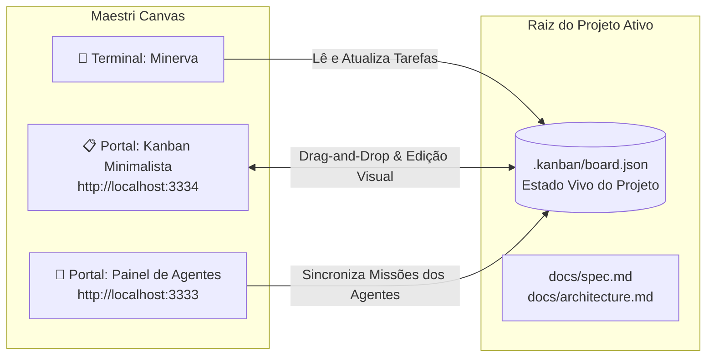

---
tags:
  - ai/opcionais
  - kanban
  - maestri
  - orquestracao
  - produtividade
categoria: Opcionais
nome: kanban-minerva
autor: lk-feitosa
local: "http://localhost:3334"
updated_at: "2026-11-10T00:45:00-03:00"
---

# 📋 Kanban Minimalista do Projeto — Minerva & Maestri

> [!NOTE] **Quadro Ágil Nativo, Leve e Isolado por Projeto (Zero Docker, Zero Auth)**  
> O **Kanban Minimalista da Minerva** é uma aplicação ágil no estilo Trello integrada diretamente ao ecossistema local. Ela é servida instantaneamente na sua própria porta dedicada **`3334`** (`http://localhost:3334`), sem necessidade de contêineres Docker, sem banco de dados PostgreSQL e sem burocracia de telas de login. Todas as tarefas, colunas e checklists são sincronizados diretamente com o arquivo **`.kanban/board.json`** na raiz do projeto ativo.



---

## Principais Recursos e Benefícios

1. **Zero Sobrecarga de Hardware (Sem Docker):**
   * Não precisa manter o Docker Desktop aberto, nem contêineres consumindo gigabytes de memória RAM.
   * Abre em milissegundos e roda com menos de 20 MB de consumo de memória.

2. **Drag-and-Drop 100% Funcional e Fluido:**
   * Arraste cartões livremente entre as colunas (**Backlog**, **A Fazer**, **Em Progresso**, **Revisão**, **Concluído**).
   * As alterações são salvas automaticamente no disco em tempo real (`.kanban/board.json`).

3. **Checklists Interativos Direto no Cartão:**
   * Marque ou desmarque caixas de seleção com 1 clique direto no card.
   * Barra de progresso visual colorida atualizada instantaneamente.

4. **Isolamento Completo por Projeto:**
   * Cada pasta de projeto possui seu próprio arquivo `.kanban/board.json`.
   * Quando você abre outro projeto no Maestri, o Kanban automaticamente exibe as tarefas daquele workspace específico.

5. **Bidirecionalidade com a Minerva:**
   * A Minerva pode criar cartões, atribuir agentes (`@Minerva`, `@Front-end`, `@Back-end`, `@QA`) e atualizar o status das tarefas.
   * Você pode criar novos cartões, editar descrições e mover tarefas pelo mouse. Ambos conversam através do mesmo arquivo JSON!

---

## Como Abrir no Maestri Canvas

No terminal da Minerva ou no terminal do Maestri, execute o comando de criação do Portal:

```bash
maestri portal create http://localhost:3334 "Kanban"
```

O quadro surgirá imediatamente como uma janela limpa e elegante no Canvas, pronta para uso sem exigir qualquer login.

---

## Estrutura do Arquivo `.kanban/board.json`

O quadro é versionável e fica salvo na raiz do projeto:

```json
{
  "versao": 2,
  "workspace": "<PROJECT_DIR>",
  "titulo": "Kanban: meu-projeto",
  "colunas": [
    { "id": "col-backlog", "titulo": "Backlog", "cor": "#64748b" },
    { "id": "col-todo", "titulo": "A Fazer", "cor": "#38bdf8" },
    { "id": "col-progresso", "titulo": "Em Progresso", "cor": "#fbbf24" },
    { "id": "col-revisao", "titulo": "Revisão", "cor": "#a855f7" },
    { "id": "col-concluido", "titulo": "Concluído", "cor": "#22c55e" }
  ],
  "cartoes": [
    {
      "id": "card-01",
      "colunaId": "col-todo",
      "titulo": "KB-001: Implementar Autenticação",
      "descricao": "Criação de tokens e middleware de segurança",
      "prioridade": "alta",
      "agente": "Back-End Specialist",
      "etiquetas": ["backend", "auth"],
      "checklist": [
        { "id": "chk-1", "texto": "Modelagem de usuários", "concluido": true },
        { "id": "chk-2", "texto": "Rota de login e hash de senha", "concluido": false }
      ]
    }
  ]
}
```

---

## Repositório Oficial

* **Código-Fonte:** [github.com/lk-feitosa/kanban-agents](https://github.com/lk-feitosa/kanban-agents)
* **Skill Integrada:** [[Skills/kanban-agents|📋 kanban-agents]] · [[Skills/minerva|🦉 minerva]]
* **Nota:** O Kanban Minimalista (`:3334`, `.kanban/board.json`) substituiu o uso do `@kan.bn/mcp` e do Docker do `kanbn/kan`.
