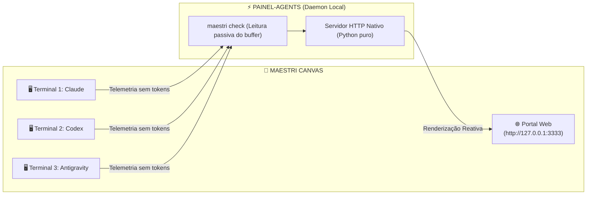

---
tags:
  - ai/opcionais
  - ferramentas
  - maestri
  - telemetria
  - cotas
  - monitoramento
categoria: Opcionais
nome: painel-agents
autor: lk-feitosa
github: "https://github.com/lk-feitosa/painel-agents"
updated_at: "2026-11-13T00:30:00Z"
---

# Painel de Agentes (Maestri) — Telemetria & Cotas em Tempo Real

> [!NOTE] **Ferramenta Opcional de Monitoramento Local**  
> Painel leve, nativo e não intrusivo para acompanhar visualmente múltiplos agentes de IA (**Claude Code**, **Codex**, **Antigravity**) operando simultaneamente no canvas do **Maestri**.



---

## Principais Recursos

1. **Zero Gasto de Tokens (Zero Cost):**
   * Não faz chamadas de LLM para monitorar agentes.
   * Utiliza telemetria passiva via buffer do terminal e expressões regulares determinísticas sobre a statusline.
2. **Auto-Descoberta de Workspace:**
   * Detecta automaticamente os terminais e agentes pertencentes ao canvas ativo via `maestri list`.
3. **Nativo no Maestri Canvas:**
   * Cria automaticamente um nó de navegador (*Portal*) na porta `3333` lado a lado com os terminais no canvas.
4. **Visualizador Web do Kanban Embutido:**
   * Sincroniza continuamente as missões ativas dos agentes com base no quadro Kanban do projeto, populando a tabela de telemetria e alertando no "Precisa de você".
   * Funciona como fallback visual instantâneo no Maestri Canvas mesmo quando o Docker do Kan estiver desligado.
5. **Auto-Descoberta de Roles & Agentes do Maestri:**
   * Detecta automaticamente os terminais e roles configurados em `.maestri/roles/` no workspace do projeto ativo.
   * Filtra rigorosamente portais e sticky notes, garantindo que apenas terminais de agentes reais apareçam na tabela.
   * Inclui telemetria sintetizada da Minerva (Orquestrador) com cotas e modelo em tempo real.
6. **Monitoramento de Cotas e Modelos:**
   * Uso de janela de contexto (%).
   * Consumo de cotas periódicas (5h) e semanais (%).
   * Modelo carregado e estado operacional (*pensando, trabalhando, ocioso, aguardando confirmação*).
7. **Privacidade e Segurança Estrita:**
   * 100% offline vinculado exclusivamente a `127.0.0.1`.
   * Sanitização e mascaramento automático de chaves de API (`sk-`, `ghp_`, `sbp_`) e senhas no buffer.
8. **Zero Dependências Externas:**
   * Desenvolvido com Python 3 Standard Library pura (sem necessidade de `pip install` ou `npm install`).

---

## Repositório e Skill Associada

* **Código-Fonte:** [github.com/lk-feitosa/painel-agents](https://github.com/lk-feitosa/painel-agents)
* **Skill Associada:** [[Skills/painel-agents|🔌 painel-agents]]

---

## Como Instalar e Rodar

### 1. Instalação (1-Click, feita uma única vez)

```bash
git clone https://github.com/lk-feitosa/painel-agents.git
cd painel-agents
instalar.bat   # Windows (ou ./instalar.sh no Linux/macOS)
```

*(Ou deixe o `setup.ps1` / `setup.sh` do `minerva-workspace` clonar e configurar automaticamente).*

---

### 2. Como Usar

Em qualquer terminal dentro do seu workspace no Maestri, execute:

```bash
painel
```

O comando irá:
1. Identificar todos os agentes ativos no canvas.
2. Iniciar o daemon de telemetria local (`127.0.0.1:3333`).
3. Invocar a API do Maestri (`maestri portal create`) abrindo o painel visual no seu canvas.

#### Parâmetros Opcionais:
| Opção | Descrição |
| :--- | :--- |
| `painel` | Inicia servidor e abre Portal no canvas automaticamente (padrão) |
| `painel --porta 3334` | Especifica uma porta customizada |
| `painel --intervalo 5` | Taxa de amostragem em segundos (padrão: 10s) |
| `painel --sem-portal` | Inicia o servidor HTTP sem abrir o card de Portal no Maestri |
| `painel --uma-vez` | Faz uma única varredura e imprime os status no terminal |

---

## Como os Agentes Interagem com o Painel

Como a skill `painel-agents` está instalada na biblioteca global, qualquer agente no Maestri pode responder a comandos em linguagem natural:
* *"Abra o painel de agentes no canvas"*
* *"Verifique como estão as cotas do time"*
* *"Cheque o status dos terminais"*

O agente invocará o comando nativo sem requerer nenhuma intervenção manual.
