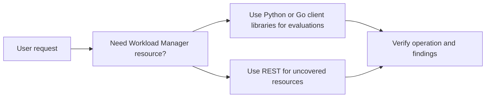

---
tags:
  - ai/skill/doc
  - skill/google-workload-manager-basics
skill: "google-workload-manager-basics"
source: "references\public-mcp-status.md"
updated_at: "2026-11-08T08:03:33.294Z"
---

# Documento: public-mcp-status (Skill: google-workload-manager-basics)

> [!NOTE] Documentação de suporte da skill **[[Visão Geral|google-workload-manager-basics]]**.  
> **Caminho de origem:** `references\public-mcp-status.md`

---

# Workload Manager Public MCP Status

No public Workload Manager MCP server is currently documented. Do not write
examples that imply Workload Manager has a public MCP integration.

Use public client libraries or the REST API for production workflows.

## Current Recommendation

## Safety Rules

-   Require a project, location, evaluation ID, and explicit resource scope for
    mutating operations.
-   Default list operations to read-only roles.
-   Require confirmation before deleting evaluations or executions.
-   Surface BigQuery export destinations and CMEK key names before creating or
    updating evaluations.

