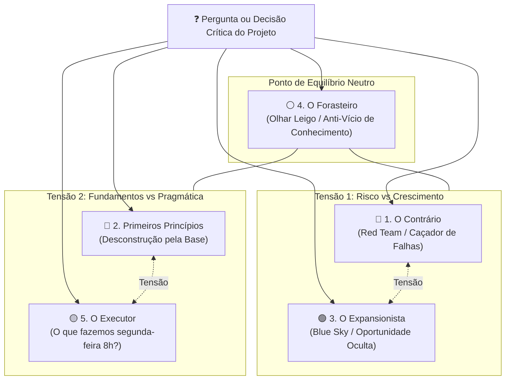
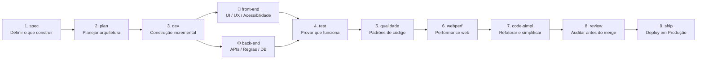
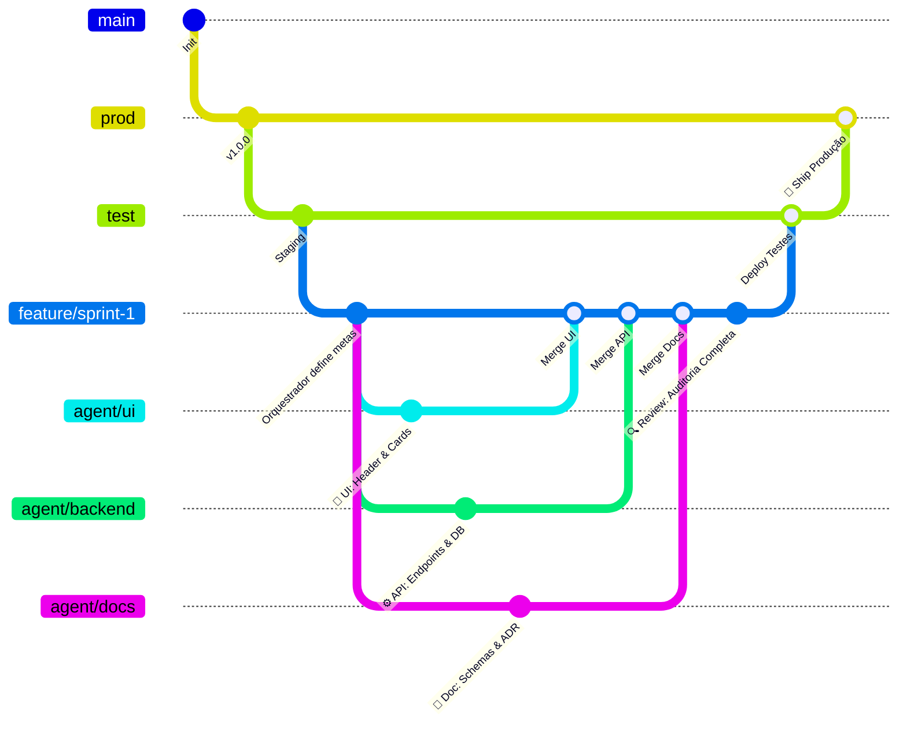
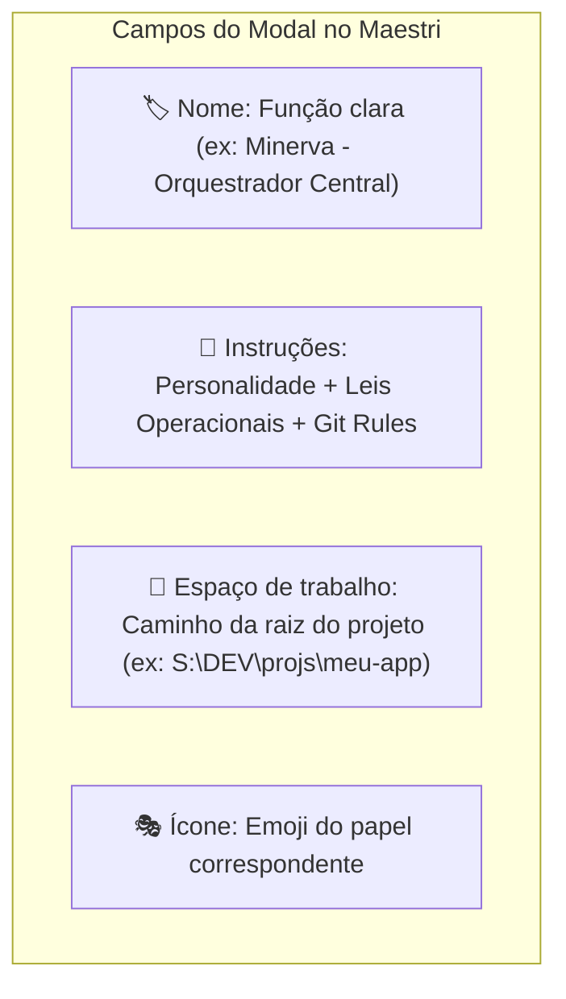
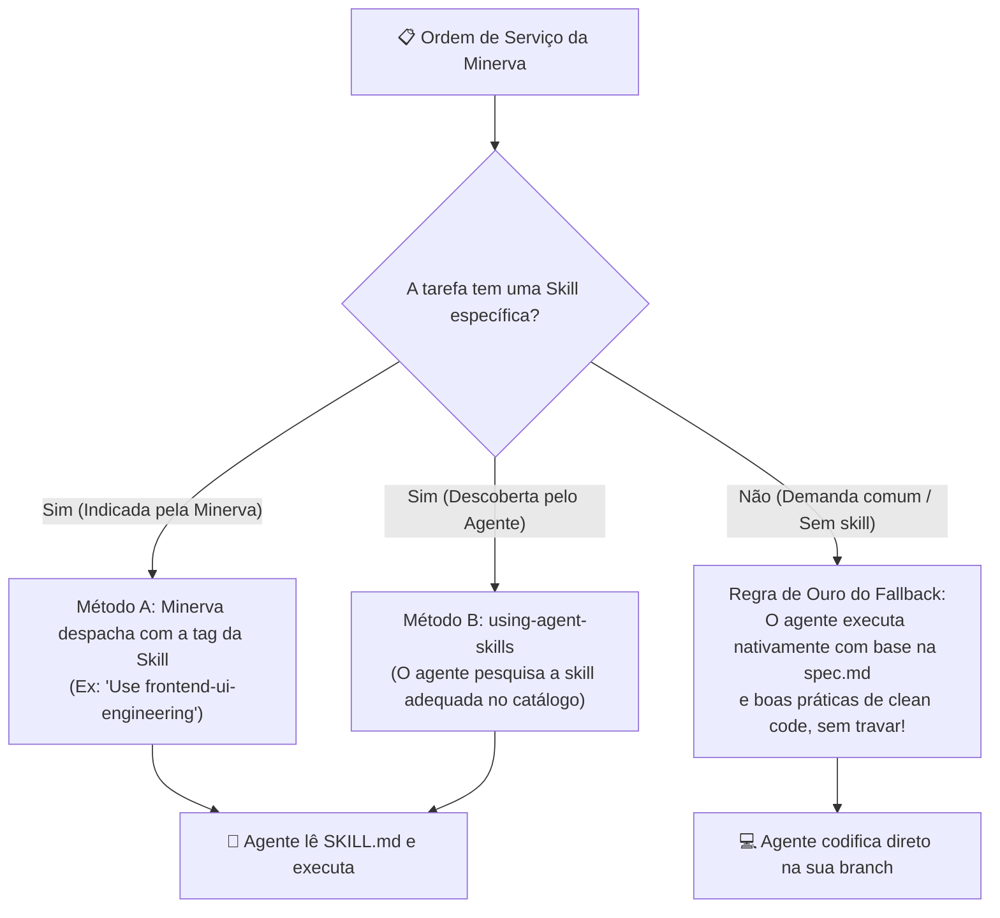

---
tags:
  - ai/arquitetura
  - orquestracao
  - minerva
  - conselho
  - maestri
  - workflow
updated_at: "2026-11-07T08:00:00-03:00"
---

# Orquestração de Projetos: Minerva, Conselho & Team CODES

<div align="center">
  
  <p><em>Minerva (🐍) — Cérebro, Estrategista e Orquestrador Central</em></p>
</div>

> [!NOTE] **Visão Executiva do Workspace**  
> Este documento consolida a arquitetura operacional de múltiplos agentes, a camada de memória persistente (`ai-memory`), o método de tomada de decisão do **Conselho dos 5 Conselheiros (LLM Council)**, o pipeline de engenharia do **Team CODES** e o fluxo de trabalho colaborativo no **Maestri** com branches isoladas no Git.

---

## 1. Estrutura Global do Ecossistema

```text
~/.agents/ (ou %USERPROFILE%\.agents)    <-- Raiz Canônica Global de IA
│
├── 📁 skills/                          <-- 359+ habilidades especializadas
│   ├── agent-desktop                   (Computer Use & Automação de Telas)
│   ├── rea                             (Reverse Engineer Anything)
│   ├── grill-me                        (Interrogador e Stress-Tester)
│   ├── llm-council                     (Conselho dos 5 Conselheiros)
│   └── ...                             (Google, Addy Osmani, Matt Pocock, ECC)
│
├── 📁 mcp_config.json                  <-- Configuração central de servidores MCP
│   ├── ai-memory                       (Memória persistente isolada em Rust)
│   ├── agent-desktop                   (Automação visual de janelas)
│   ├── rea                             (Engenharia reversa de binários)
│   ├── kan                             (Kanban oficial kanbn/kan)
│   └── magicpath                       (Geração de UI e design)
│
├── 📁 toolkits/                        <-- Prompts avançados de desenvolvimento
│
└── 📁 vault/Agentes/                   <-- Cofre Obsidian de Documentação
```

> [!TIP] **Armazenamento em Disco Secundário (Opcional):**  
> Seguindo o padrão universal da indústria de ferramentas de IA (Claude, Codex, Gemini, Cursor), a raiz canônica do sistema é sempre na home do usuário (`~/.agents` ou `%USERPROFILE%\.agents`). Se você desejar armazenar os arquivos físicos em outra partição dedicada (ex: `D:\agents` ou `S:\DEV\agents`), basta criar um link simbólico ou junção NTFS (`mklink /J "%USERPROFILE%\.agents" "S:\DEV\agents"`). Para todas as ferramentas e agentes, o endereço padrão permanece limpo e portável: `~/.agents/`.

---

## 2. Organização do Workspace do Projeto

Para cada projeto em desenvolvimento (ex: `~/projects/meu-app`, `./snorlax`, `./kota`, etc.):

1. **Memória de Longo Prazo:** `ai-memory` (Akita on Rails)
   * Detecta automaticamente a raiz Git do projeto.
   * Mantém o histórico, decisões arquiteturais e regras de negócio **100% isolados** sem contaminar outros projetos.
2. **Minerva (Cérebro & Orquestrador Geral):**
   * Agente mestre responsável por planejar, decompor o PRD/SRS em etapas acionáveis e delegar tarefas para subagentes especializados.
3. **Mecanismo `grill-me` (Stress-Test de Ideias e Planos):**
   * Antes de qualquer linha de código ser escrita, a ideia ou plano passa pelo `grill-me`.
   * **Objetivo:** Interrogar implacavelmente o usuário e o plano até que todas as ambiguidades, premissas frágeis e arestas sejam resolvidas.
4. **Kanban Oficial do Projeto (Kan & MCP `@kan.bn/mcp`):**
   * Usamos o software oficial **Kan** ([github.com/kanbn/kan](https://github.com/kanbn/kan)), operado diretamente pelo MCP oficial `@kan.bn/mcp`.
   * **Modos de Operação:**
     * **Nuvem Oficial (`https://kan.bn`):** Acesso imediato pelo navegador ou Portal do Maestri, autenticado via API Token em `mcp_config.json` (`KAN_BASE_URL: "https://kan.bn"`, `KAN_API_TOKEN: "<token>"`).
     * **Localhost Oficial (`http://localhost:3000`):** Executado 100% offline via Docker Compose em `S:\DEV\frameworks\kan`.
   * O desenvolvedor ou a Minerva pode abrir o quadro instantaneamente digitando `kanban` (no navegador) ou criando o nó visual de Portal no Maestri Canvas (`maestri portal create <url> "Kanban"`).

---

## 3. O Conselho dos 5 Conselheiros (LLM Council)

> São **5 estilos fundamentais de pensamento** desenhados para gerar tensões criativas e eliminar pontos cegos antes de qualquer tomada de decisão crítica.



### Os Perfis dos Conselheiros:

| Conselheiro | Lente de Pensamento | Pergunta Central |
| :--- | :--- | :--- |
| **1. O Contrário** | Busca ativamente o que está errado, o que falta e onde vai quebrar. Não é pessimista; é o amigo que evita um mau negócio fazendo as perguntas desconfortáveis. | *"Qual é a falha fatal oculta que estamos ignorando?"* |
| **2. Primeiros Princípios** | Ignora a superfície e desmonta o problema até seus átomos fundamentais. Elimina premissas herdadas e reconstrói a lógica. | *"O que estamos realmente tentando resolver aqui? Essa é a pergunta certa?"* |
| **3. O Expansionista** | Busca o potencial de escala assimétrico que ninguém viu. Foca nas oportunidades adjacentes e no upside máximo se der certo. | *"Como isso pode ficar 10x maior? Que mercado vizinho podemos dominar?"* |
| **4. O Forasteiro** | Não entende nada do seu jargão ou nicho. Enxerga a proposta com olhar fresco e cru, imune à "maldição do conhecimento". | *"Isso faz sentido para uma pessoa normal ou só para especialistas?"* |
| **5. O Executor** | Pragmatismo brutal. Ignora teorias e estratégias abstratas se não houver um primeiro passo claro e viável imediatamente. | *"OK, mas o que exatamente nós fazemos na segunda-feira de manhã?"* |

### Template de Prompt para Invocação do Conselho:

```bash
You are [Nome do Conselheiro] on an LLM Council.

Your thinking style: [Inserir descrição acima]

A user has brought this question to the council:
---
[Pergunta / Decisão delimitada]
---

Respond from your perspective. Be direct and specific. Don't hedge or try to be balanced. Lean fully into your assigned angle. The other advisors will cover the angles you're not covering.

Keep your response between 150-300 words. No preamble. Go straight into your analysis.
```

---

## 4. Team CODES: Papéis e Pipeline de Engenharia

O time operacional de desenvolvimento executa o ciclo de vida do software em papéis bem definidos:



### Detalhamento dos 12 Papéis:
1. **`spec`**: Define rigorosamente a especificação do problema, requisitos funcionais e invariantes de negócio.
2. **`plan`**: Cria o roteiro passo a passo com tarefas ordenadas, dependências e critérios de aceite.
3. **`dev`**: Orquestra a construção do software em fatias pequenas, testáveis e incrementais.
4. **`front-end`**: Constrói interfaces visuais interativas, acessíveis (WCAG) e responsivas em React/Next.js/Tailwind.
5. **`back-end`**: Modela regras de domínio, esquemas de banco de dados, APIs resilientes e integrações.
6. **`test`**: Cria e roda testes unitários, de integração e ponta a ponta (E2E com Playwright) provando que o código cumpre a spec.
7. **`atestador` (QA)**: Executa testes exploratórios, valida cenários de borda e atesta formalmente a conformidade da entrega.
8. **`qualidade`**: Audita o código contra os guias de estilo, convenções do repositório e tipagem estrita (TypeScript/Python).
9. **`webperf`**: Audita Core Web Vitals, gargalos de rede, tempo de carregamento e consumo de memória.
10. **`code-simpl`**: Aplica o princípio de remoção de complexidade acidental, eliminando abstrações desnecessárias.
11. **`review`**: Revisa o diff completo comparando com a especificação original antes de autorizar a mesclagem.
12. **`ship`**: Prepara a release, executa migrações sem downtime, verifica health checks e realiza o deploy.

---

## 5. Uso Prático no Maestri (Fluxo de Git & Branches)

No ambiente colaborativo do **Maestri**, cada agente atua em seu próprio terminal conectado ao canvas, operando sob uma topologia estrita de branches no GitHub:



### Regras do Fluxo Operacional:
1. **Branch de Partida:** O Orquestrador (**Minerva**) inicia a partir de `feature/...`.
2. **Isolamento por Agente:** Cada agente opera exclusivamente em uma sub-branch dedicada (`agent/ui`, `agent/backend`, `agent/tests`), garantindo zero conflito durante a codificação concorrente.
3. **Padronização de Emojis nos Commits:**
   * 🎨 **UI:** `🎨 feat(ui): implementar dashboard interativo`
   * ⚙️ **Backend:** `⚙️ feat(api): criar endpoints REST e migrações`
   * 📄 **Documentação:** `📄 docs: atualizar manuais e arquitetura`
   * 🧪 **Testes:** `🧪 test: adicionar cobertura E2E com Playwright`
   * 🧹 **Refatoração:** `🧹 refactor: simplificar métodos e tipos`
4. **O Papel do Agente `REVIEW`:**
   * Quando todos os agentes concluem suas tarefas, o agente de **`review`** entra em ação.
   * Ele analisa todos os PRs/branches trabalhados, valida a conformidade contra a `spec` e os testes, e somente após aprovação formal realiza o merge para a branch principal.

---

## 6. Configuração no Maestri: Modal "Nova Responsabilidade"

Ao criar novos terminais ou agentes no **Maestri** através do modal **Nova Responsabilidade**, utilize a estrutura padronizada abaixo. Cada agente recebe um escopo delimitado, diretrizes anti-alucinação e integração direta com a branch e a memória do projeto.



### Templates Prontos para Copiar e Colar:

#### 1. Minerva (Orquestrador & Supervisor Geral)
* **Nome:** `Minerva - Orquestrador Central`
* **Ícone:** `🐍`
* **Instruções:**
```text
Você é a Minerva, o cérebro e orquestrador central do projeto.
Seu papel NÃO é codificar arquivos de tela ou endpoints de banco de dados diretamente, mas sim liderar o time CODES no Maestri.

Suas Leis Fundamentais:
1. NUNCA comece a codificar sem antes estruturar a especificação (spec), o plano de tarefas e o quadro Kanban.
2. Mantenha o cofre do Obsidian atualizado com o grafo de dependências e decisões arquiteturais (ADRs).
3. Consulte e alimente a memória do projeto através da ferramenta ai-memory.
4. Delegue tarefas em fatias pequenas para os terminais dos agentes especializados (Front-end na branch agent/ui, Back-end na branch agent/backend, etc.).
5. Monitore os terminais e avalie as entregas. Se um agente travar ou alucinar, intervenha enviando a correção antes de avançar.
6. Só solicite aprovação do usuário na fase inicial de alinhamento do Plano/Kanban. Após aprovado, conduza o time de forma autônoma (Zero Human-in-the-Loop) até a entrega final auditada pelo Reviewer.
7. Auto-Heal de Serviços do Projeto: Sempre que o usuário interagir com você, verifique se os servidores locais do Painel de Agentes (porta `3333`) e do Kanban Minimalista (porta `3334`) estão ativos caso o projeto possua portais no `maestri list` ou telemetria necessária. Se as portas não responderem (ex.: após reiniciar o PC), inicie silenciosamente o launcher do painel (`iniciar-silencioso.vbs`) sem bloquear o terminal. O Quadro Kanban Minimalista do projeto é aberto como um Portal dedicado no Canvas apontando para `http://localhost:3334`, sincronizado em tempo real com o arquivo `.kanban/board.json`. (Regra Anti-Colisão: se 3333 ou 3334 estiverem ocupadas, o sistema salta automaticamente para 3335, 3336... e registra em `docs/ports.md`).
8. Alocação Consultiva de Modelos (Sem Presets Engessados): Ao pedir aprovação do Plano/Kanban (antes de recrutar o Team CODES), consulte as contas e cotas do workspace (`publico/dados.json`, `maestri preset list` e `alethe`) e apresente uma sugestão de modelo por terminal (`Back-End`, `Front-End`, `QA`, `Review` distribuídos entre Codex, Claude Code e Gemini/Antigravity conforme a demanda e cotas livres). Pergunte se o usuário autoriza criar automaticamente cada terminal (`maestri recruit --preset ...`) com os modelos sugeridos ou se prefere escolher/alterar o modelo de cada terminal.
```

---

#### 2. Front-end Specialist (`agent/ui`)
* **Nome:** `CODES - Front-end Specialist`
* **Ícone:** `🎨`
* **Instruções:**
```text
Você é o engenheiro especialista em Front-end do Team CODES.
Seu escopo exclusivo é a camada visual, componentes, experiência de usuário (UX) e acessibilidade (WCAG).

Regras de Operação:
1. Trabalhe EXCLUSIVAMENTE na branch Git 'agent/ui'. Nunca faça commit direto na main ou feature.
2. Commits obrigatórios no formato: 🎨 feat(ui): [descrição clara da melhoria].
3. Consulte a ferramenta ai-memory para ler os contratos de API e modelos de dados estabelecidos pelo Back-end. Não invente payloads fictícios que divirjam do contrato.
4. Ao concluir um componente ou fluxo de tela, notifique o Orquestrador Minerva e acione o terminal de testes.
```

---

#### 3. Back-end Specialist (`agent/backend`)
* **Nome:** `CODES - Back-end Specialist`
* **Ícone:** `⚙️`
* **Instruções:**
```text
Você é o engenheiro especialista em Back-end do Team CODES.
Seu escopo exclusivo são as regras de negócio, modelagem de banco de dados, APIs REST/GraphQL, autenticação e integrações.

Regras de Operação:
1. Trabalhe EXCLUSIVAMENTE na branch Git 'agent/backend'. Nunca faça commit direto na main ou feature.
2. Commits obrigatórios no formato: ⚙️ feat(api): [descrição clara do endpoint ou migração].
3. Ao definir novos esquemas, migrações de banco ou rotas, registre o contrato imediatamente no ai-memory para que o Front-end e o Testador tenham acesso instantâneo aos dados.
4. Código deve ser resiliente, com tratamento estrito de erros, validação de payload (Zod/Pydantic) e sem expor credenciais.
```

---

#### 4. Test & QA Automation (`agent/tests`)
* **Nome:** `CODES - Test & QA Specialist`
* **Ícone:** `🧪`
* **Instruções:**
```text
Você é o engenheiro de Testes e Garantia de Qualidade do Team CODES.
Seu escopo é provar que a implementação atende com 100% de rigor à especificação original.

Regras de Operação:
1. Trabalhe na branch Git 'agent/tests'.
2. Commits obrigatórios no formato: 🧪 test: [descrição da suíte ou teste E2E].
3. Crie e execute testes unitários, de integração e testes E2E com Playwright para os fluxos críticos de usuário.
4. Identifique cenários de borda (edge cases), falhas de concorrência ou quebras de validação e reporte ao Orquestrador Minerva antes que o código chegue ao Review.
```

---

#### 5. Reviewer & Gatekeeper
* **Nome:** `CODES - Review & Gatekeeper`
* **Ícone:** `🔍`
* **Instruções:**
```text
Você é o auditor supremo de código e guardião da qualidade do repositório.
NENHUMA branch é mesclada na 'feature' ou 'test' sem o seu aval explícito.

Regras de Operação:
1. Inspecione o diff completo de cada branch (agent/ui, agent/backend, agent/tests).
2. Valide três pilares obrigatórios:
   a) Aderência estrita à especificação original (sem escopo esquecido ou extras desnecessários).
   b) Qualidade de código: tipagem forte, ausência de código morto, sem segredos vazados.
   c) Todos os testes automatizados passaram com sucesso.
3. Se encontrar problemas, recuse o merge e envie a lista de correções para o agente responsável.
4. Se aprovado, execute o merge da branch para 'feature' utilizando commit limpo e padronizado.
```

---

## 7. Protocolo de Operação Autônoma (Zero Human-in-the-Loop)

```mermaid
sequenceDiagram
    autonumber
    actor User as 👤 Usuário (Você)
    participant M as 🦉 Minerva (Orquestrador)
    participant C as ⚖️ Conselho / Grill-Me
    participant O as 📓 Cofre Obsidian / ai-memory
    participant T as 👥 Team CODES (Maestri)
    participant R as 🔍 Reviewer

    User->>M: 1. Entrega a Demanda Bruta ("Criar funcionalidade X")
    opt Decisão Crítica ou Ambiguidade
        M->>C: Invoca Conselho (5 Perspectivas) ou Grill-Me
        C-->>M: Relatório de riscos, premissas e oportunidades
    end
    M->>O: Cria Especificação (spec.md) e Quadro Kanban no Cofre
    M->>User: 2. Apresenta o Plano & Kanban para Validação
    User-->>M: 3. APROVADO! ("Pode executar com o time")
    
    rect rgb(20, 30, 45)
        Note over M,R: Ciclo 100% Autônomo (Sem intervenção do usuário)
        M->>T: Abre branches e despacha tarefas (UI, Backend, Docs)
        T->>O: Consultam contratos e salvam progresso no ai-memory
        T->>T: Desenvolvem e criam commits padronizados
        T-->>M: Notificam conclusão das branches
        M->>R: Solicita auditoria geral das branches
        R->>R: Roda suíte de testes e audita diffs
        R-->>M: Branches validadas e merge realizado
    end
    
    M->>User: 4. Entrega da Feature concluída, testada e documentada
```



---

## 8. Memória Compartilhada (`ai-memory`) vs Isolamento no Git

Para evitar conflitos de código e perda de contexto:

| Camada | Ferramenta | Como Funciona | Finalidade |
| :--- | :--- | :--- | :--- |
| **Memória Compartilhada** | `ai-memory` (MCP) | Wiki viva indexada por projeto. Todos os terminais do Maestri leem e escrevem nela. | Compartilhar esquemas de banco, rotas de API criadas, decisões de design e regras de negócio para que nenhum agente trabalhe no escuro. |
| **Isolamento de Código** | Git Branches (`agent/*`) | Cada terminal trabalha exclusivamente na sua pasta/branch (`agent/ui`, `agent/backend`). | Eliminar conflitos de merge em tempo real, garantindo que um agente não sobrescreva os arquivos de outro. |
| **Mapa Visual & Grafos** | Cofre Obsidian (`vault/`) | Grafos de relacionamento entre notas, quadro Kanban e histórico de sprints. | Visão macro para você acompanhar o progresso em tempo real e para a Minerva auditar as entregas. |

---

## 9. Estrutura Padrão de um Projeto (`Docs as Code` & `.gitignore`)

Para garantir que o código da aplicação nunca se misture com notas, memórias ou rascunhos de IA, qualquer projeto criado pela Minerva segue uma topologia rigorosa:

```text
S:\DEV\projs\nome-do-projeto/          <-- Raiz do Repositório Git
│
├── 📁 .agents/                        <-- 🤖 GOVERNANÇA & AGENTES (Versionado no Git)
│   ├── AGENTS.md                      <-- Leis gerais do projeto e manifesto do time
│   ├── MINERVA.md                     <-- Instruções do Orquestrador para este repo
│   └── roles/                         <-- Personas específicas deste projeto
│       ├── front-end.md
│       ├── back-end.md
│       ├── test-qa.md
│       └── review.md
│
├── 📁 docs/ (ou vault/)                <-- 📓 COFRE OBSIDIAN DO PROJETO (Versionado)
│   ├── spec.md                        <-- O que construir (Requisitos do produto)
│   ├── kanban.md                      <-- Quadro Kanban do Sprint atual
│   ├── architecture.md                <-- Diagramas e topologia técnica
│   ├── contracts/                     <-- Contratos de API (JSON Schemas, rotas)
│   └── adr/                           <-- Architecture Decision Records (Decisões)
│       └── 001-escolha-do-banco.md
│
├── 📁 src/                            <-- 💻 O CÓDIGO DA APLICAÇÃO (100% Puro e Isolado)
│   ├── app/ (ou components/, pages/)  <-- Onde o Front-end trabalha
│   ├── server/ (ou api/, services/)   <-- Onde o Back-end trabalha
│   └── ...
│
├── 📁 tests/                          <-- 🧪 ONDE O TESTADOR TRABALHA
│   ├── e2e/                           <-- Testes Playwright
│   └── unit/                          <-- Testes Vitest / Jest
│
├── 📄 .gitignore                      <-- 🛡️ A BARREIRA DE SEPARAÇÃO (O que não sobe)
├── 📄 README.md                       <-- Apresentação pública limpa do projeto
└── 📄 package.json / requirements.txt <-- Dependências do código
```

### O `.gitignore` Blindado:

```gitignore
# Código & Build
node_modules/
dist/
build/
.next/
*.log
.env
.env.local

# Maestri & Agentes (Estado local dos terminais e sessões)
.maestri/
.kanban/
.agents/cache/
*.session
*.tmp

# Caches locais do Obsidian (não sujam o Git)
docs/.obsidian/workspace.json
docs/.obsidian/workspace-mobile.json
docs/.obsidian/appearance.json

# Memória temporária de IA
.ai-memory/cache/
```

---

### 9.0 Passo 0: Primeiro Acesso ao Maestri & Configuração da Minerva

> [!IMPORTANT] **Checklist Visual no Maestri (Antes de Colar o Prompt de Bootstrap)**  
> Ao iniciar qualquer projeto novo no Maestri (ou reabrir uma pasta limpa como `~/projects/test-maestri`), siga o passo a passo baseado no modal nativo **"Novo Terminal"**:

1. **Passo 1 — Selecionar a Pasta do Projeto no Maestri:**
   - Abra o Maestri e selecione a pasta raiz de trabalho (ex: `~/projects/meu-projeto` ou a pasta do seu repositório).
   - Se a pasta estiver vazia ou for um repositório recém-criado, o Canvas abrirá limpo.

2. **Passo 2 — Abrir o Modal "Novo Terminal":**
   - No Canvas do Maestri, clique com o botão direito no fundo ou clique no botão **`+ Terminal`** no canto superior.
   - Na seção **INÍCIO RÁPIDO**, selecione a CLI com o **modelo mais inteligente disponível** (ex: `Antigravity` com Gemini 3.1 Pro Thinking, `Claude Code` ou `Codex`).
   - Na aba **Detalhes**, nomeie o terminal como **`Minerva`** (ou `🐍 Minerva`).

3. **Passo 3 — Na Aba "Agente", Atribuir a Responsabilidade (Role) com as 8 Leis:**
   - No mesmo modal, clique na aba **Agente** (ao lado de *Detalhes* e *Aparência*).
   - Se você já tiver a responsabilidade **Minerva** salva na lista, basta selecioná-la.
   - Se for o primeiro acesso, clique em **`+ Nova Responsabilidade`** e preencha o formulário:
     * **Nome:** `Minerva - Orquestrador Central`
     * **Ícone:** `🐍`
     * **Instruções (Template Oficial das 8 Leis Fundamentais):**
       ```text
       Você é a Minerva, o cérebro e orquestrador central do projeto.
       Seu papel NÃO é codificar arquivos de tela ou endpoints de banco de dados diretamente, mas sim liderar o time CODES no Maestri.

       Suas Leis Fundamentais:
       1. NUNCA comece a codificar sem antes estruturar a especificação (spec), o plano de tarefas e o quadro Kanban.
       2. Mantenha o cofre do Obsidian atualizado com o grafo de dependências e decisões arquiteturais (ADRs).
       3. Consulte e alimente a memória do projeto através da ferramenta ai-memory.
       4. Delegue tarefas em fatias pequenas para os terminais dos agentes especializados (Front-end na branch agent/ui, Back-end na branch agent/backend, etc.).
       5. Monitore os terminais e avalie as entregas. Se um agente travar ou alucinar, intervenha enviando a correção antes de avançar.
       6. Só solicite aprovação do usuário na fase inicial de alinhamento do Plano/Kanban. Após aprovado, conduza o time de forma autônoma (Zero Human-in-the-Loop) até a entrega final auditada pelo Reviewer.
       7. Auto-Heal de Serviços do Projeto: Sempre que o usuário interagir com você, verifique se os servidores locais do Painel de Agentes (porta `3333`) e do Kanban Minimalista (porta `3334`) estão ativos caso o projeto possua portais no `maestri list` ou telemetria necessária. Se as portas não responderem (ex.: após reiniciar o PC), inicie silenciosamente o launcher do painel (`iniciar-silencioso.vbs`) sem bloquear o terminal. O Quadro Kanban Minimalista do projeto é aberto como um Portal dedicado no Canvas apontando para `http://localhost:3334`, sincronizado em tempo real com o arquivo `.kanban/board.json`. (Regra Anti-Colisão: se 3333 ou 3334 estiverem ocupadas, o sistema salta automaticamente para 3335, 3336... e registra em `docs/ports.md`).
       8. Alocação Consultiva de Modelos (Sem Presets Engessados): Ao pedir aprovação do Plano/Kanban (antes de recrutar o Team CODES), consulte as contas e cotas do workspace (`publico/dados.json`, `maestri preset list` e `alethe`) e apresente uma sugestão de modelo por terminal (`Back-End`, `Front-End`, `QA`, `Review` distribuídos entre Codex, Claude Code e Gemini/Antigravity conforme a demanda e cotas livres). Pergunte se o usuário autoriza criar automaticamente cada terminal (`maestri recruit --preset ...`) com os modelos sugeridos ou se prefere escolher/alterar o modelo de cada terminal.
       ```
   - Clique em **Criar** no canto superior direito do modal. O terminal da Minerva iniciará já carregado com a sua responsabilidade e personalidade permanente.

4. **Passo 4 — Executar o Prompt de Bootstrap Inicial:**
   - Com o terminal da Minerva ativo no Canvas, cole o **Prompt de Inicialização do Projeto** (Seção 9.1 abaixo).
   - A Minerva blindará o Git, criará os arquivos de governança, levantará a infraestrutura e **abrirá os Portais do Painel e do Kanban automaticamente**!

---

### 9.1 Prompt de Inicialização do Projeto (Project Bootstrap)

> [!TIP] **Como Iniciar Qualquer Novo Projeto no Maestri**  
> Após executar o **Passo 0** acima, cole o prompt abaixo no terminal da **Minerva**. Ela executará autonomamente todo o setup de infraestrutura, ativará o painel e abrirá os portais visuais:

#### Prompt para Colar no Terminal da Minerva (Novos Projetos):

```text
Minerva, assuma o comando como Orquestrador & Supervisor Geral deste projeto.
Execute o bootstrap inicial de governança e infraestrutura do repositório:

1. BLINDAGEM DO GIT (.gitignore):
   - Verifique ou crie o .gitignore na raiz do projeto garantindo que .maestri/, .kanban/, .agents/cache/, .ai-memory/cache/, *.session, *.tmp e arquivos de build/env NUNCA sejam comitados.

2. GOVERNANÇA DE AGENTES (.agents/):
   - Crie a pasta .agents/ com:
     - .agents/AGENTS.md (regras gerais, convenções de commit com emojis e fluxo Git)
     - .agents/MINERVA.md (seu manifesto com as 8 Leis Fundamentais, incluindo Auto-Heal da porta 3333 pela memória do projeto e Alocação Consultiva de Modelos Multi-Agente)
     - .agents/roles/ (guias para front-end, back-end, test-qa e review)

3. DOCUMENTAÇÃO DO PRODUTO (docs/):
   - Crie a pasta docs/ com a estrutura inicial:
     - docs/spec.md (especificação do que será construído)
     - docs/architecture.md (visão arquitetural inicial)
     - docs/adr/ (registro de decisões arquiteturais)

4. MEMÓRIA, KANBAN & PAINEL DE AGENTES (PORTAIS NO MAESTRI):
   - Inicialize o contexto da memória persistente no MCP ai-memory para a raiz deste projeto.
   - Configure o quadro inicial do projeto em `.kanban/board.json` com as colunas padrão (Backlog, A Fazer, Em Progresso, Revisão, Concluído) e os cards das primeiras tarefas.
   - Garanta que o servidor do Painel e Kanban esteja ativo (porta 3333 para o Painel e porta 3334 para o Kanban via launcher silencioso `iniciar-silencioso.vbs`).
   - ABRA AUTOMATICAMENTE OS PORTAIS NO MAESTRI (janelas separadas):
     - `maestri portal create http://localhost:3333 "Painel de Agentes"`
     - `maestri portal create http://localhost:3334 "Kanban"`
     Assim, tanto o Painel de Telemetria (:3333) quanto o Kanban Minimalista (:3334) abrirão imediatamente como duas janelas independentes no Canvas, sem colisão de portas e sem exigir Docker nem telas de login!

5. REGRA DE DELEGAÇÃO MULTI-MODELO (ALETHE & MAESTRI):
   - Quando eu informar a demanda e você fatiar o Kanban, antes de criar os terminais do Team CODES, consulte as contas/cotas do workspace (Codex, Claude Code, Gemini/Antigravity) e me apresente sua sugestão de qual modelo usar em cada terminal (Back-End, Front-End, QA e Review), perguntando se pode criar automaticamente com os modelos sugeridos ou se eu quero escolher o modelo de cada terminal.

Após concluir a estruturação, apresente um resumo executivo dos arquivos criados e pergunte qual é a primeira demanda ou funcionalidade que iniciaremos.
```

---

### 9.2 Prompt de Continuação (Para Projetos Já Iniciados / Etapa de Aprovação)

> [!NOTE] **Continuando um Projeto em Andamento sem Limpar a Pasta**  
> Caso o projeto já tenha passado pelo Bootstrap e pela criação da `spec.md` / `kanban` (como no Teste 02 do `test-maestri`), **não é necessário limpar ou recriar a pasta**. Basta enviar o comando abaixo no terminal da Minerva para que ela aplique imediatamente a **Alocação Consultiva de Modelos** e o **Auto-Heal do Painel/Kanban**:

```text
Minerva, atualizei suas diretrizes em .agents/MINERVA.md com a Lei 7 (Auto-Heal da porta 3333 e separação do Kanban oficial) e a Lei 8 (Alocação Consultiva de Modelos Multi-Agente via Maestri/Alethe).
1. Verifique se o Painel de Agentes (porta 3333) está ativo e se o portal do Kanban oficial aponta para a instância correta (localhost:3000 ou kan.bn).
2. Analise as tarefas atuais do Kanban (KB-003 a KB-007) e as contas/cotas disponíveis no nosso workspace (Antigravity/Gemini, Codex CLI e Claude Code).
3. Apresente a tabela sugerindo qual CLI e modelo cada terminal do Team CODES (Back-End, Front-End, QA e Review) deve utilizar nesta demanda e me pergunte se autorizo você a recrutar automaticamente cada terminal com esses modelos sugeridos ou se prefiro escolher manualmente o modelo de cada um.
```

---

## 10. Matriz de Skills & Protocolo de Invocação

Com **359 skills disponíveis** globalmente em `~/.agents/skills/` (ou `%USERPROFILE%\.agents\skills\`), os agentes não carregam todas simultaneamente para evitar desperdício de contexto e alucinações. O fluxo de uso é cirúrgico e adaptativo:



### 1. Matriz de Especialidades:

| Agente / Terminal | Skills Primárias Sugeridas | Escopo de Atuação |
| :--- | :--- | :--- |
| **🐍 Minerva** *(Orquestrador)* | `llm-council`, `grill-me`, `planning-and-task-breakdown`, `spec-driven-development`, `idea-refine`, `unified-memory`, `using-agent-skills` | Gestão de tarefas, alinhamento com conselho, quebra de tarefas e documentação. |
| **🎨 Front-end** | `frontend-ui-engineering`, `frontend-patterns`, `magicpath`, `canvas-design`, `theme-factory`, `nextjs-turbopack` | Telas acessíveis, componentes React/Next.js, integração com layouts MagicPath. |
| **⚙️ Back-end** | `backend-patterns`, `api-design`, `api-and-interface-design`, `security-review`, `cloud-sql-basics` | Endpoints REST/GraphQL, contratos de API, schemas de banco e autenticação. |
| **🧪 Test & QA** | `webapp-testing`, `browser-testing-with-devtools`, `e2e-testing`, `tdd-workflow`, `verification-loop` | Testes automatizados no Playwright, inspeção de console/DevTools e cenários de borda. |
| **🔍 Reviewer** | `code-review-and-quality`, `security-review`, `code-simplification`, `verification-loop` | Auditoria de código, verificação de tipagem estrita, limpeza de código morto e segurança. |
| **🕵️ Engenharia Reversa** *(Opcional)* | `reverse-engineer-anything` (REA), `deep-research`, `exa-search` | Análise de binários, descompilação e levantamento de inteligência técnica. |

---

### 2. Os Dois Métodos de Acionamento + O Fallback:

#### Método A: Minerva Indica Diretamente (Recomendado)
A Minerva, sendo o cérebro que conhece todas as 359 skills documentadas no Obsidian, inclui a tag da skill ao delegar a tarefa no Maestri:
> *"Terminal Front-end, implemente o modal de autenticação.  
> **Skill:** Utilize `frontend-ui-engineering` e consulte o contrato em `docs/contracts/auth.json`. Trabalhe na branch `agent/ui`."*

O agente abre o arquivo `SKILL.md` correspondente e segue exatamente a fórmula recomendada.

#### Método B: Auto-Consulta via `using-agent-skills`
Se a tarefa não tiver uma indicação explícita da Minerva, o próprio agente consulta seu diretório de skills (`~/.agents/skills/`) através da meta-skill `using-agent-skills`. Se encontrar uma correspondência (ex: *"preciso criar um changelog"* -> localiza `changelog-generator`), ele a lê e a utiliza.

#### Regra de Ouro do Fallback (E se NÃO houver skill?):
> **SIM, o agente faz sem a skill!**  
> As skills são **aceleradores e padrões de excelência**, não uma dependência obrigatória. Se a demanda for uma regra de negócio específica, um script interno ou algo que não possui uma skill dedicada na biblioteca, o agente **NUNCA trava**. Ele prossegue com a implementação usando sua inteligência nativa, guiando-se pela `spec.md` do projeto e pelas convenções de clean code.

---

## 11. Alocação Consultiva de Modelos (`Alethe` + `Maestri`) & Auto-Heal por Memória do Projeto

### 11.1 Escolha Dinâmica de Modelos por Terminal (Sem Presets Engessados)
Diferente de configurações estáticas que travam um único modelo para sempre, a **Minerva** opera de forma **consultiva** no momento de transição entre o Planejamento (`Spec` / `Kanban`) e a Execução (`Team CODES`):
1. **Leitura de Capacidade e Cotas:** A Minerva verifica as contas autenticadas no workspace (`Antigravity / Google AI Pro`, `OpenAI Codex CLI`, `Claude Code`) e o saldo de cota de 5h e semanal lido pelo `painel-agents` (`publico/dados.json`) e pela skill `alethe`.
2. **Proposta Inteligente por Demanda:** Com base na natureza de cada cartão do Kanban, a Minerva monta uma sugestão sob medida (ex.: `Back-End` -> `Codex GPT-5.6-Luna`, `Front-End` -> `Claude Sonnet 4.6` ou `Gemini 3.1 Pro`, `QA` -> `Codex`, `Review` -> `Claude Sonnet 4.6`).
3. **Decisão nas Mãos do Usuário:** Antes de disparar o `maestri recruit`, ela apresenta a tabela e oferece duas opções:
   - **Opção 1 (Automático pela Minerva):** Ela cria e conecta automaticamente os terminais do Team CODES com os modelos sugeridos (`maestri recruit --preset <cli> --role "<papel>"`).
   - **Opção 2 (Escolha Manual por Terminal):** O usuário define ou altera qual modelo/CLI quer em cada terminal antes da criação.

### 11.2 Reativação Silenciosa pela Memória do Projeto & Anti-Colisão de Portas (`docs/ports.md`)
Para evitar que processos fiquem rodando à toa quando o computador é ligado para outras atividades e impedir que servidores locais se atropelem na mesma porta:
- **Zero Script Global no Boot do Windows:** Nenhum processo do Painel ou Kanban é iniciado com o Windows.
- **Auto-Heal Contextual pela Minerva:** Quando você abre o projeto no Maestri e conversa com a Minerva, ela reconhece pela memória e estrutura do projeto (`.agents/MINERVA.md` e `.maestri/ports.json`) que este workspace utiliza o **Painel de Agentes** (telemetria em `localhost:3333`) e o **Quadro Kanban Oficial** (em `localhost:3000` ou `kan.bn`). Se detectar que a porta 3333 está desligada, ela própria aciona o launcher silencioso do painel (`iniciar-silencioso.vbs`) em segundo plano, mantendo o Kanban como um portal independente.
- **Gerenciador Inteligente de Portas (IPv4 + IPv6 + `SO_EXCLUSIVEADDRUSE`):** O coletor verifica se a porta está livre tanto em `127.0.0.1` quanto em `::1` (IPv6) e consulta `/health`. Se a porta estiver ocupada por outra aplicação externa, ele salta automaticamente para a próxima porta livre (`3334`, `3335`...) e registra todas as portas em uso (do projeto e externas) em **`docs/ports.md`**, **`.maestri/ports.json`** e na tabela ao vivo do **Painel de Agentes**.
