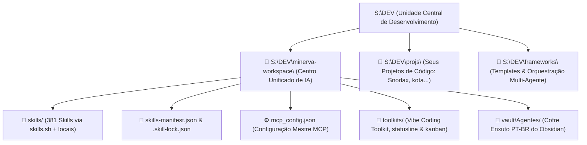
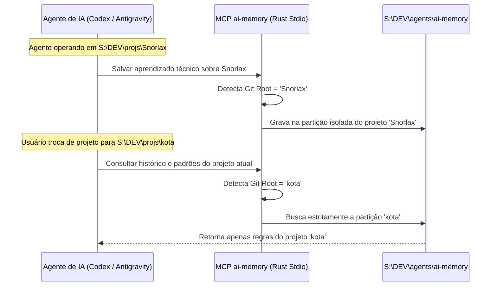

---
tags:
  - ai/arquitetura
  - documentacao
  - infraestrutura
  - ecossistema
updated_at: "2026-11-06T15:47:00-03:00"
---

# Arquitetura, Conceito & Organização Global do Ecossistema de IA

> [!NOTE] **Objetivo Deste Documento**  
> Registrar a visão técnica, os fundamentos de engenharia, a topologia de armazenamento no disco `S:`, os mecanismos de links simbólicos (NTFS Junctions), o isolamento de projetos via MCP (`ai-memory`) e a organização das 350+ skills no Obsidian.

---

## 1. A Ideia & Motivação

Historicamente, cada ferramenta de IA instalada no Windows (Codex, Claude Code, Antigravity, Hermes Agent, Ollama, etc.) cria arquivos e modelos nos diretórios de perfil de usuário dentro da unidade do sistema:
* `C:\Users\lukas\.agents`
* `C:\Users\lukas\.codex`
* `C:\Users\lukas\AppData\Local\...`

Essa abordagem fragmentada causa três problemas graves:
1. **Sobrecarga do Drive `C:`**: Modelos, caches de pacotes, compilações e repositórios consomem espaço valioso do SSD do sistema operacional.
2. **Falta de Portabilidade e Backup**: Dificuldade para clonar, versionar ou sincronizar o ambiente caso o sistema seja formatado ou migrado.
3. **Contaminação de Contexto entre Projetos**: IAs interagindo com projetos diferentes (como `Snorlax`, `kota`, etc.) acabam misturando regras de negócio, históricos e memórias se configuradas de forma ingênua.

### A Solução Adotada
Consolidar **100% dos dados, ferramentas, repositórios, skills, frameworks e cofre do Obsidian** na unidade de desenvolvimento dedicada:
$$\mathbf{S:\backslash DEV}$$

---

## 2. Topologia do Disco `S:\DEV`



### Detalhamento dos Diretórios Principais:
| Diretório | Função | Conteúdo |
| :--- | :--- | :--- |
| `S:\DEV\minerva-workspace\` | Núcleo único do ecossistema de IA | Repositório Git mestre contendo skills, manifesto `skills.sh`, configurações MCP, toolkits e cofre do Obsidian. |
| `S:\DEV\frameworks\` | Frameworks de orquestração | `alethe-agents`, `agent-teams-ai`, `claude-cookbooks`, `ottomator-agents`, `openwork`, `scrapling`. |
| `S:\DEV\projs\` | Projetos de desenvolvimento | Código-fonte dos sistemas reais (ex: `Snorlax`, `kota`, etc.), totalmente isolados. |

---

## 3. A Estratégia de NTFS Junctions & Symlinks (Ponte Transparente no SO)

As ferramentas de IA normalmente procuram configurações na pasta de usuário (`~` ou `%USERPROFILE%`).  
Para contornar isso **sem duplicar arquivos e mantendo uma única biblioteca centralizada**, o sistema cria **Junções de Diretório NTFS** no Windows (`mklink /J`) ou **Links Simbólicos** no Linux/Mac (`ln -s`):

```mermaid
flowchart LR
    subgraph Usuario [Diretório do Usuário (~ ou %USERPROFILE%)]
        C_AGENTS["~/.agents"]
        C_CODEX["~/.codex/skills"]
        C_CLAUDE["~/.claude/skills"]
        C_GEMINI["~/.gemini/config/skills"]
    end
    
    subgraph Central [Repositório Central Clonado]
        S_AGENTS["S:\DEV\minerva-workspace"]
        S_SKILLS["S:\DEV\minerva-workspace\skills"]
    end
    
    C_AGENTS -. Junction / Symlink .-> S_AGENTS
    C_CODEX -. Junction / Symlink .-> S_SKILLS
    C_CLAUDE -. Junction / Symlink .-> S_SKILLS
    C_GEMINI -. Junction / Symlink .-> S_SKILLS
```

### O que o Usuário Baixa vs O que o Setup Faz:
1. **No Clone do Git:** O usuário baixa o repositório unificado (`minerva-workspace`), `skills-manifest.json`, `.skill-lock.json`, toolkits e o cofre enxuto do Obsidian em PT-BR. Bancos binários e caches locais ficam fora via `.gitignore`.
2. **No Setup (`setup.ps1` / `setup.bat` / `setup.sh`):** O script cria as pontes transparentes do sistema operacional. Com isso, **Claude Code, Codex, Antigravity, Gemini CLI e Maestri** passam a consultar a mesma pasta unificada sem redundância.

> [!TIP] **Por que Junctions e não atalhos comuns (.lnk)?**  
> Uma junção NTFS opera em nível de sistema de arquivos do kernel do Windows. Para qualquer processo (Node.js, Python, Git, Claude, Codex), o caminho `C:\Users\lukas\.agents` é lido como uma pasta física real, mas todo byte escrito vai instantaneamente para `S:\DEV\minerva-workspace`.

---

## 4. Protocolo MCP & Isolamento de Memória (`ai-memory`)

### O Desafio do Isolamento
Quando você trabalha no projeto `Snorlax` e depois no `kota`, como garantir que o agente não misture regras de um repositório no outro?

### Como o `ai-memory` (Akita on Rails) Resolve:
1. **Binário Nativo em Rust**: Instalado em `C:\Users\lukas\AppData\Local\Programs\ai-memory\ai-memory.exe`.
2. **Execução via Stdio MCP**: Invocado automaticamente pelas IAs através do protocolo padrão MCP.
3. **Detecção Dinâmica do Projeto**:  
   O `ai-memory` inspeciona a raiz do repositório Git atual (`git rev-parse --show-toplevel`) ou o diretório de execução (`cwd`).
   - Ao executar dentro de `S:\DEV\projs\Snorlax`, todo conhecimento gerado e memorizado é indexado com o escopo `Snorlax`.
   - Ao trocar para `S:\DEV\projs\kota`, o escopo muda imediatamente para `kota`.
   - Um projeto **nunca tem acesso** às notas, memórias ou segredos técnicos do outro.
4. **Armazenamento Centralizado**: A base bruta e banco de dados SQLite/Markdown ficam salvos com segurança em `S:\DEV\agents\ai-memory`.



---

## 5. A Estrutura Enxuta do Cofre no Obsidian (100% PT-BR)

Para evitar duplicar documentação de terceiros em inglês dentro do cofre, `S:\DEV\minerva-workspace\vault\Agentes` mantém **apenas notas resumidas em PT-BR** com tags de categoria e links diretos para os repositórios oficiais e `skills.sh`:

```text
S:\DEV\minerva-workspace\vault\Agentes\
│
├── 📄 _Hub de Skills & MCPs.md                      <-- Dashboard Geral
├── 📄 _Arquitetura e Documentação do Ecossistema.md <-- Esta Nota
│
├── 📁 Workspace/                                    <-- Governança Minerva & Team CODES
│
├── 📁 Skills/                                       <-- 381 notas resumidas PT-BR + 8 Hubs
│   ├── 🎨 Design, UI & Frontend Systems.md
│   ├── 🏗️ Arquitetura, Planejamento & TDD.md
│   ├── 🤖 Orquestração, Agentes & Maestri.md
│   ├── agent-desktop.md
│   └── ... (1 nota enxuta por skill)
│
├── 📁 MCP/                                          <-- Servidores do Protocolo MCP
│   ├── _Visão Geral MCP.md
│   ├── ai-memory.md                                 (Akita on Rails)
│   ├── agent-desktop.md                             (Vercel Labs - Computer Use)
│   ├── rea.md                                       (Reverse Engineer Anything)
│   ├── kan.md                                       (Kanban MCP)
│   └── magicpath.md                                 (Design Engine)
│
├── 📁 MODS/                                         <-- Toolkits
│   └── vibe-coding-toolkit.md
│
├── 📁 Frameworks/                                   <-- Arquiteturas de Agentes
│   ├── _Visão Geral Frameworks.md
│   └── ...
│
└── 📁 Opcionais/                                    <-- Utilitários de Apoio & Produtividade
    ├── _Visão Geral Opcionais.md
    ├── painel-agents.md                             (Telemetria e monitor de cotas Maestri)
    ├── kan-kanban.md                                (Quadro Kanban contextual por projeto)
    └── ai-statusline.md                             (Barra de status leve para terminal)
```

---

## 6. Gestão Inteligente de Contexto e Orçamento de Tokens nas IDEs

Ao inspecionar as configurações no **Antigravity IDE** ou ferramentas similares com centenas de habilidades (378 skills), é exibido o aviso:
`Customization token budget exceeded. Large customizations are excluded from context.`

### O que isso significa e por que é o comportamento correto?
1. **Proteção da Janela de Contexto:** Se uma IA injetasse as instruções completas de 378 skills simultaneamente no prompt inicial, gastaria mais de **57.000 tokens** antes mesmo do usuário fazer uma pergunta.
2. **Hierarquia de Prioridade:**
   * **Rules (Regras Globais):** Têm prioridade máxima (sempre carregadas 100% no contexto).
   * **MCP Tools:** São disponibilizadas como esquemas compactos de ferramentas (como visto no IDE: `rea`, `agent-desktop`, `kan`).
   * **Skills:** Ficam indexadas globalmente com a tag `Global`. O IDE mantém seus metadados e demite o corpo extenso de skills não usadas até que sejam invocadas pelo usuário ou ativadas sob demanda.

---

## 8. Manutenção e Atualizações via `skills.sh`

As skills de terceiros podem ser descobertas e atualizadas diretamente usando o gerenciador oficial da Vercel (`npx skills find` / `npx skills update -g`), evitando cópias redundantes no cofre do Obsidian.

---

## Resumo dos Benefícios Conquistados

1. **Unificação Real**: Todas as IAs (Antigravity, Codex, Claude Code, Hermes, Maestri) bebem da mesma fonte de dados no disco `S:`.
2. **Drive C: Limpo & Rápido**: O SSD do sistema permanece livre de gigabytes de repositórios e modelos.
3. **Privacidade e Isolamento**: O `ai-memory` impede vazamento de contexto entre projetos distintos.
4. **Navegação Produtiva no Obsidian**: Documentação viva, com links bidirecionais (`[[...]]`), visualização em grafo e pesquisa instantânea.
