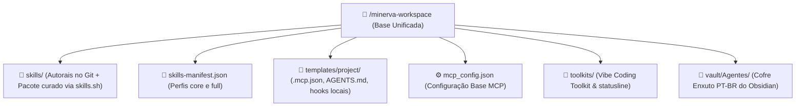
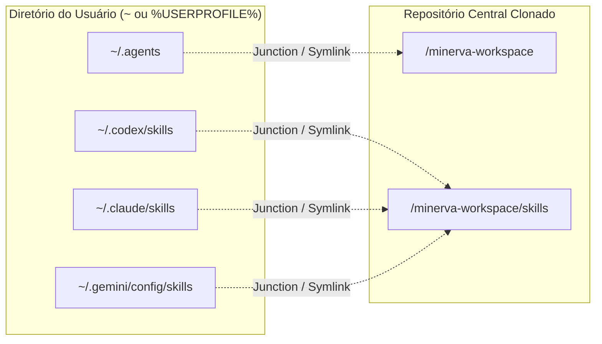

---
tags:
  - ai/arquitetura
  - documentacao
  - infraestrutura
  - ecossistema
updated_at: "2026-11-13T00:30:00Z"
---

# Arquitetura, Conceito & Organização Global do Ecossistema de IA

> [!NOTE] **Objetivo Deste Documento**  
> Registrar a visão técnica, os links simbólicos (NTFS Junctions / symlinks), a divisão entre **Base Global de Skills** e **Ativação `/minerva` por Workspace**, e o isolamento de projetos via MCP (`ai-memory`, `context-mode`).

---

## 1. A Ideia & Motivação

Historicamente, cada ferramenta de IA instalada (Codex, Claude Code, Antigravity, Gemini CLI, etc.) cria diretórios separados no perfil de usuário:
* `~/.agents`
* `~/.codex`
* `~/.claude`
* `~/.gemini/config`

Essa abordagem fragmentada causa três problemas:
1. **Duplicação de Skills:** precisar baixar/atualizar skills separadamente em cada ferramenta e em cada projeto.
2. **Saturação de Contexto & Tokens:** carregar centenas de skills ou despejar logs extensos do terminal direto na janela do modelo.
3. **Contaminação de Contexto entre Projetos:** IAs interagindo com projetos distintos acabam misturando regras e memórias.

### A Solução Adotada (Modelo Híbrido)
1. **Base Global Única (`minerva-workspace`):** centraliza as skills autorais (`minerva`, `painel-agents`, `kanban-agents`), `skills-manifest.json`, `mcp_config.json`, `templates/`, `toolkits/` e este cofre do Obsidian em um único repositório conectado por **Junctions / Symlinks**.
2. **Ativação por Workspace (`/minerva`):** ao entrar em um projeto e rodar `/minerva`, apenas aquele workspace ativa `context-mode` (MCP), `rtk` local opcional, `painel-agents` (`:3333`) e `kanban-agents` (`:3334`) apontando para `.kanban/board.json` — mantendo terminais fora do projeto 100% limpos.

---

## 2. Topologia do Repositório



---

## 3. NTFS Junctions & Symlinks (Ponte Transparente no SO)

Para que **Claude Code, Codex, Antigravity, Gemini CLI e Maestri** enxerguem exatamente a mesma pasta global sem duplicação:



> [!TIP] **Por que Junctions no Windows e não atalhos (.lnk)?**  
> Uma junção NTFS (`mklink /J`) opera em nível de sistema de arquivos. Para Node.js, Python, Git, Claude ou Codex, `~/.agents` funciona como uma pasta física real, apontando diretamente para onde você clonou o repositório.

---

## 4. Protocolo MCP & Isolamento de Memória (`ai-memory`)

1. **Execução via Stdio MCP:** o `ai-memory` inspeciona a raiz Git atual (`git rev-parse --show-toplevel`) ou diretório de trabalho (`cwd`).
2. **Isolamento por Repositório:** decisões gravadas no `Projeto-A` nunca contaminam consultas no `Projeto-B`.
3. **Economia de Contexto no Projeto (`context-mode`):** inserido pelo `/minerva` no `.mcp.json` do workspace via `npx -y context-mode`, executando comandos/leituras extensas em sandbox (`ctx_execute`, `ctx_search`).

---

## 5. A Estrutura Enxuta do Cofre no Obsidian (100% PT-BR)

`vault/Agentes/` mantém **apenas notas resumidas em PT-BR** com tags de categoria e links diretos para os repositórios oficiais e `skills.sh`:

```text
vault/Agentes/
├── 📄 _Hub de Skills & MCPs.md
├── 📄 _Arquitetura e Documentação do Ecossistema.md
├── 📁 Workspace/      (Governança Minerva, Conselho & Team CODES)
├── 📁 Skills/         (Notas resumidas PT-BR + 7 Hubs de Categoria)
├── 📁 MCP/            (ai-memory, agent-desktop, rea, magicpath)
├── 📁 MODS/           (vibe-coding-toolkit)
├── 📁 Frameworks/     (alethe-agents, claude-cookbooks, etc.)
└── 📁 Opcionais/      (painel-agents :3333, kanban-agents :3334, ai-statusline)
```

---

## 6. Gestão Inteligente de Contexto (`core` vs `full`)

* Carregar centenas de skills genéricas de uma só vez excede o *token budget* das IDEs (`Customization token budget exceeded`).
* Por padrão, o `setup` instala o **perfil `core` (35 skills essenciais + 3 autorais)** focado em Orquestração, Economia de Contexto (`ponytail`, `context-mode`), UI/UX (`transitions-dev`, `shadcn`, `@react-bits`), TDD, Segurança e Automação. Pacotes específicos de um projeto são descobertos sob demanda com **`find-skills`** (`npx skills find <termo>`).
