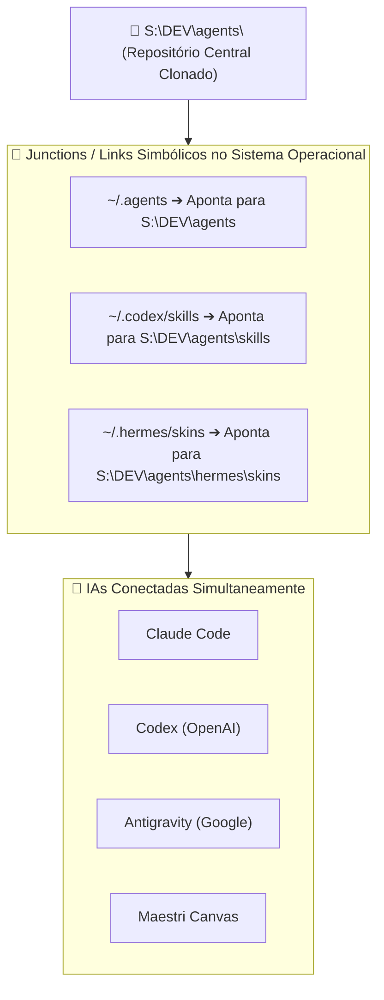

---
tags:
  - ai/setup
  - guia-de-instalacao
  - replicacao
  - automacao
updated_at: "2026-11-06T16:19:00-03:00"
---

# Guia Passo a Passo: Como Replicar Este Ecossistema em Outro PC

> [!NOTE] **Objetivo Deste Guia**  
> Fornecer um roteiro 100% reproduzível (com comandos prontos e script automatizado) para montar exatamente a mesma estrutura em qualquer outro computador (Desktop, Notebook ou Servidor).

---

## 1. Pré-Requisitos no Novo Computador

Antes de rodar os scripts, instale as seguintes ferramentas na nova máquina:
1. **Git for Windows:** `winget install Git.Git`
2. **Node.js (LTS v20+):** `winget install OpenJS.NodeJS.LTS`
3. **Python 3.11+ / uv:** `winget install Python.Python.3.12` ou `winget install astral-sh.uv`
4. **Obsidian:** `winget install Obsidian.Obsidian`
5. *(Opcional / Recomendado)* **GitHub CLI:** `winget install GitHub.cli`

> [!TIP] **Escolha do Drive**  
> Neste setup usamos `S:\DEV`. Se no outro PC você tiver apenas o drive `C:`, `D:` ou `E:`, a estrutura funciona de forma idêntica! Basta substituir a letra do drive nos comandos abaixo.

---

## 2. Estrutura de Pastas Alvo

No drive escolhido (ex: `S:\DEV`), a hierarquia padrão a ser criada é:

```text
S:\DEV\
├── 📁 agents/            <-- Repositório central de IA (Skills, MCPs, Skins, Vault)
│   ├── skills/
│   ├── mcp_config.json
│   ├── hermes/skins/
│   ├── toolkits/
│   ├── ai-memory/
│   └── vault/Agentes/    <-- O Cofre que você abre no Obsidian
├── 📁 frameworks/        <-- Bibliotecas e templates de orquestração multi-agente
├── 📁 apps/              <-- Aplicações locais aceleradas por GPU/CPU
└── 📁 projs/             <-- Onde ficam seus projetos de código (Snorlax, kota...)
```

---

## O que é Baixado no Clone vs O que o Setup Faz no Sistema

### 1. O que é clonado de fato na máquina (Arquivos Físicos do Git):
Ao rodar `git clone https://github.com/lk-feitosa/minerva-workspace.git S:\DEV\agents`, você baixa exclusivamente a camada de inteligência, configurações e manuais:

| Pasta / Arquivo | O que contém |
| :--- | :--- |
| **`skills/`** | As 368 skills de desenvolvimento prontas para uso imediato. |
| **`mcp_config.json`** | Configuração dos servidores MCP ativos (`ai-memory`, `rea`, `agent-desktop`, `magicpath`). |
| **`hermes/skins/`** | 16 temas customizados em YAML para estilizar terminais. |
| **`toolkits/`** | Prompts avançados de desenvolvimento do Vibe Coding Toolkit. |
| **`assets/minerva/`** | Avatares oficiais da Minerva (incluindo `profile-03.jpg`). |
| **`vault/Agentes/`** | O cofre do Obsidian completo (notas, workspace, opcionais, plugins pré-instalados). |
| **`setup.bat` / `.ps1` / `.sh`** | Scripts de automação 1-click para Windows, Linux e macOS. |

> [!NOTE] **O que NÃO é baixado (Blindado pelo .gitignore):**  
> Dependências pesadas (`node_modules/`), bancos binários do `ai-memory/`, caches de terminais e arquivos de layout de janela (`workspace.json`). O repositório permanece leve, rápido para baixar e livre de lixo de sistema operacional.

---

### 2. O que o Script ou Prompt da IA faz no seu Sistema:
O instalador **NÃO copia nem duplica arquivos**. Ele utiliza **NTFS Junctions** no Windows ou **Links Simbólicos (`ln -s`)** no Linux/Mac para unificar o sistema operacional:



#### Benefícios Desta Abordagem:
1. **Fonte Única da Verdade:** Em vez de manter 368 skills duplicadas na pasta de cada ferramenta, existe apenas uma pasta física no disco.
2. **Atualização Instantânea:** Quando você adiciona, edita ou atualiza uma skill em `skills/`, o Claude Code, o Codex, o Antigravity e o Maestri recebem a atualização no mesmo segundo.
3. **Zero Poluição:** Seu diretório de usuário (`C:\Users\...` ou `~`) fica limpo, sem arquivos pesados ocupando espaço no drive do sistema.

---

## 3. Script de Instalação Automatizada (PowerShell)

Abra o **PowerShell como Administrador** no novo computador (necessário para criar os NTFS Junctions) e execute o script abaixo:

```powershell
# ==============================================================
# SCRIPT DE REPLICAÇÃO GLOBAL DO ECOSSISTEMA DE IA
# ==============================================================

$TARGET_DRIVE = "S:\DEV"  # Altere para D:\DEV ou C:\DEV se desejar
$AGENTS_DIR = "$TARGET_DRIVE\agents"
$FRAMEWORKS_DIR = "$TARGET_DRIVE\frameworks"
$APPS_DIR = "$TARGET_DRIVE\apps"
$PROJS_DIR = "$TARGET_DRIVE\projs"

Write-Host "🚀 Iniciando criação da estrutura em $TARGET_DRIVE..." -ForegroundColor Cyan

# 1. Criar Diretórios Raiz
New-Item -ItemType Directory -Path "$AGENTS_DIR\skills" -Force | Out-Null
New-Item -ItemType Directory -Path "$AGENTS_DIR\toolkits" -Force | Out-Null
New-Item -ItemType Directory -Path "$AGENTS_DIR\hermes\skins" -Force | Out-Null
New-Item -ItemType Directory -Path "$AGENTS_DIR\ai-memory" -Force | Out-Null
New-Item -ItemType Directory -Path "$FRAMEWORKS_DIR" -Force | Out-Null
New-Item -ItemType Directory -Path "$APPS_DIR" -Force | Out-Null
New-Item -ItemType Directory -Path "$PROJS_DIR" -Force | Out-Null

# 2. Clonar Pacotes de Skills
Write-Host "📦 Clonando repositórios de Skills..." -ForegroundColor Yellow
cd "$AGENTS_DIR\skills"

# Repositórios com pastas diretas de skills
git clone --depth 1 https://github.com/google/skills google-skills-temp
Get-ChildItem -Path ".\google-skills-temp\skills" | Move-Item -Destination ".\" -Force
Remove-Item -Path ".\google-skills-temp" -Recurse -Force

git clone --depth 1 https://github.com/addyosmani/agent-skills addy-temp
Get-ChildItem -Path ".\addy-temp\skills" | Move-Item -Destination ".\" -Force
Remove-Item -Path ".\addy-temp" -Recurse -Force

git clone --depth 1 https://github.com/mattpocock/skills matt-temp
Get-ChildItem -Path ".\matt-temp\skills" | Move-Item -Destination ".\" -Force
Remove-Item -Path ".\matt-temp" -Recurse -Force

git clone --depth 1 https://github.com/affaan-m/ECC ecc-temp
Get-ChildItem -Path ".\ecc-temp\skills" | Move-Item -Destination ".\" -Force
Remove-Item -Path ".\ecc-temp" -Recurse -Force

git clone --depth 1 https://github.com/composio-community/awesome-codex-skills codex-temp
Get-ChildItem -Path ".\codex-temp\skills" | Move-Item -Destination ".\" -Force
Remove-Item -Path ".\codex-temp" -Recurse -Force

# Skills Individuais
git clone --depth 1 https://github.com/Kc1t/alethe-orchestrate-skill alethe
git clone --depth 1 https://github.com/aiwithremy/claude-skills-llm-council llm-council

# 3. Clonar Mods & Toolkits
Write-Host "🎨 Baixando Skins do Hermes e Vibe Toolkit..." -ForegroundColor Yellow
git clone --depth 1 https://github.com/joeynyc/hermes-skins "$AGENTS_DIR\hermes\temp-skins"
Get-ChildItem -Path "$AGENTS_DIR\hermes\temp-skins\skins\*.yaml" | Copy-Item -Destination "$AGENTS_DIR\hermes\skins"
Remove-Item -Path "$AGENTS_DIR\hermes\temp-skins" -Recurse -Force

git clone --depth 1 https://github.com/soumatheusgomes/vibe-coding-toolkit "$AGENTS_DIR\toolkits\vibe-coding-toolkit"

# 4. Clonar Frameworks de Agentes
Write-Host "🧩 Clonando Frameworks em $FRAMEWORKS_DIR..." -ForegroundColor Yellow
cd "$FRAMEWORKS_DIR"
git clone --depth 1 https://github.com/Kc1t/alethe-agents
git clone --depth 1 https://github.com/777genius/agent-teams-ai
git clone --depth 1 https://github.com/anthropics/claude-cookbooks
git clone --depth 1 https://github.com/coleam00/ottomator-agents
git clone --depth 1 https://github.com/different-ai/openwork

# 5. Clonar Aplicações de IA Locais
Write-Host "🖥️ Clonando Apps de IA em $APPS_DIR..." -ForegroundColor Yellow
cd "$APPS_DIR"
git clone --depth 1 https://github.com/AUTOMATIC1111/stable-diffusion-webui
git clone --depth 1 https://github.com/lfnovo/open-notebook
git clone --depth 1 https://github.com/unslothai/unsloth

# 6. Criar NTFS Junctions no Drive C:
Write-Host "🔗 Criando NTFS Junctions transparentes no C:..." -ForegroundColor Magenta
$USER_HOME = $env:USERPROFILE

# Link .agents
if (Test-Path "$USER_HOME\.agents") { Remove-Item "$USER_HOME\.agents" -Recurse -Force }
cmd /c mklink /J "$USER_HOME\.agents" "$AGENTS_DIR"

# Link .codex\skills
New-Item -ItemType Directory -Path "$USER_HOME\.codex" -Force | Out-Null
if (Test-Path "$USER_HOME\.codex\skills") { Remove-Item "$USER_HOME\.codex\skills" -Recurse -Force }
cmd /c mklink /J "$USER_HOME\.codex\skills" "$AGENTS_DIR\skills"

# Link hermes skins
$HERMES_LOCAL = "$env:LOCALAPPDATA\hermes"
New-Item -ItemType Directory -Path $HERMES_LOCAL -Force | Out-Null
if (Test-Path "$HERMES_LOCAL\skins") { Remove-Item "$HERMES_LOCAL\skins" -Recurse -Force }
cmd /c mklink /J "$HERMES_LOCAL\skins" "$AGENTS_DIR\hermes\skins"

Write-Host "✅ Instalação base concluída com sucesso!" -ForegroundColor Green
```

---

## 4. Instalar o `ai-memory` (Akita on Rails)

1. Baixe a release para Windows (`x86_64-pc-windows-msvc`) em:  
   👉 [github.com/akitaonrails/ai-memory/releases](https://github.com/akitaonrails/ai-memory/releases)
2. Extraia o executável `ai-memory.exe` para uma pasta de programas, por exemplo:  
   `C:\Users\<seu-usuario>\AppData\Local\Programs\ai-memory\ai-memory.exe`
3. Crie o arquivo `S:\DEV\agents\mcp_config.json`:

```json
{
  "mcpServers": {
    "magicpath": {
      "url": "https://api.magicpath.ai/mcp"
    },
    "rea": {
      "command": "cmd.exe",
      "args": ["/d", "/c", "npx", "-y", "rea-agents@latest", "mcp"]
    },
    "agent-desktop": {
      "command": "cmd.exe",
      "args": ["/d", "/c", "npx", "-y", "agent-desktop@latest", "mcp"]
    },
    "ai-memory": {
      "command": "C:\\Users\\lukas\\AppData\\Local\\Programs\\ai-memory\\ai-memory.exe",
      "args": [
        "serve",
        "--transport",
        "stdio",
        "--data-dir",
        "S:\\DEV\\agents\\ai-memory"
      ]
    },
    "kan": {
      "command": "cmd.exe",
      "args": ["/d", "/c", "npx", "-y", "@kan.bn/mcp"],
      "env": {
        "KAN_BASE_URL": "http://localhost:3000",
        "KAN_API_TOKEN": "YOUR_KAN_API_TOKEN"
      }
    }
  }
}
```

---

## 5. Sincronização dos MCPs para Todas as IAs (Claude, Codex, Gemini e Maestri)

Cada IA no mercado possui sua própria forma de registrar ferramentas MCP. Nosso ecossistema resolve isso de ponta a ponta:

1. **Antigravity / Gemini CLI:**
   * O script `sync_obsidian.mjs` espelha automaticamente a configuração do `mcp_config.json` para `~/.gemini/config/mcp_config.json` formatando os comandos para o Windows (`cmd.exe /d /c npx`).
2. **Claude Code (Anthropic):**
   * Configurado via `~/.claude.json` no bloco `"mcpServers"`.
   * Você pode validar o status de todos os servidores executando no terminal:
     ```bash
     claude mcp list
     ```
3. **Codex (OpenAI):**
   * Registrado no arquivo `~/.codex/config.toml` ou através da CLI oficial do Codex:
     ```bash
     codex mcp add rea -- cmd.exe /d /c npx -y rea-agents@latest mcp
     codex mcp add agent-desktop -- cmd.exe /d /c npx -y agent-desktop@latest mcp
     codex mcp add kan --env KAN_BASE_URL=http://localhost:3000 --env KAN_API_TOKEN=YOUR_KAN_API_TOKEN -- cmd.exe /d /c npx -y "@kan.bn/mcp"
     ```
   * Valide executando: `codex mcp list`.
4. **Maestri Canvas:**
   * Como os nós de agentes do Maestri inicializam sessões do Claude Code, Codex ou Antigravity, todos os agentes em execução no canvas herdam 100% dos MCPs sem qualquer configuração adicional.

---

## 6. Ferramentas Opcionais: Uso no Terminal e no Maestri Canvas

O ecossistema dispõe de utilitários de produtividade em `S:\DEV\agents\vault\Agentes\Opcionais`:

### 1. Painel de Agentes (Telemetria & Monitor de Cotas)
* **No Terminal:** Digite `painel --uma-vez` para ver um resumo rápido de cotas e tokens no terminal, ou `painel` para iniciar o daemon local.
* **No Maestri Canvas:** Digite `painel` no terminal do canvas. Ele inicia o servidor e cria automaticamente um nó de Portal Web (`http://127.0.0.1:3333`) lado a lado com seus agentes.

### 2. Kan Kanban (Gestão de Tarefas Isolada por Projeto)
* **No Terminal:** Entre em qualquer projeto (ex: `cd S:\DEV\projs\meu-app`) e digite:
  * `kanban` — abre o quadro exclusivo do projeto no navegador padrão.
  * `kanban status` — verifica se os contêineres Docker estão ativos.
  * `kanban start` / `kanban stop` — gerencia a stack do Docker.
* **No Maestri Canvas:** Digite `kanban portal` (ou `kanban -p`). O CLI detecta o projeto e cria um nó de Portal Web no canvas exibindo o quadro Kanban em tempo real.
* **Com Minerva:** Peça no chat: *"Minerva, inicie o kanban deste projeto"* ou *"Minerva, mova o cartão para Concluído"*.

### 3. Statusline Pessoal de Terminal (`ai-statusline`)
* Barra de status minimalista e não bloqueante para Antigravity CLI e Claude Code.
* Mostra o modelo ativo, tokens e tempo de renovação da cota de 5h diretamente no rodapé de cada sessão de terminal.

---

## 7. Gerar e Sincronizar o Cofre no Obsidian

Basta rodar o script [`sync_obsidian.mjs`](file:///S:/DEV/agents/sync_obsidian.mjs) na raiz do repositório:

```bash
node S:\DEV\agents\sync_obsidian.mjs
```

Em poucos segundos ele gera:
* Todas as **368 pastas de skills** com manuais e instruções.
* A documentação de cada **MCP**.
* A lista de **Skins do Hermes** e do **Vibe Coding Toolkit**.
* As notas dos **Frameworks** e **Apps Locais**.
* O painel inicial `_Hub de Skills & MCPs.md`.

### Abrindo no Obsidian:
1. Abra o Obsidian.
2. Clique em **"Open folder as vault"** (Abrir pasta como cofre).
3. Selecione a pasta: `S:\DEV\agents\vault\Agentes`.

---

## 6. Configuração Automática via Agente de IA (Prompt Pronto)

Se você estiver usando uma IA de terminal ou código (**Antigravity**, **Claude Code**, **Codex**, **Cursor**), não precisa executar nenhum comando manual. Basta colar este prompt para o seu assistente:

```text
Você é o meu assistente de IA configurando este computador.
Acabei de clonar o ecossistema Minerva & Agents (minerva-workspace) nesta máquina.
Por favor, configure o meu ambiente para operar nesta arquitetura global unificada:

1. Identifique o meu Sistema Operacional (Windows / Linux / macOS) e a pasta onde este repositório foi clonado.
2. Em vez de utilizar diretórios individuais e isolados, configure o apontamento global criando os links necessários:
   - No Windows: Crie os NTFS Junctions vinculando:
     * %USERPROFILE%\.agents -> [caminho_deste_repositorio]
     * %USERPROFILE%\.codex\skills -> [caminho_deste_repositorio]\skills
     * %LOCALAPPDATA%\hermes\skins -> [caminho_deste_repositorio]\hermes\skins
   - No Linux ou macOS: Crie os links simbólicos (ln -s):
     * ~/.agents -> [caminho_deste_repositorio]
     * ~/.codex/skills -> [caminho_deste_repositorio]/skills
     * ~/.hermes/skins -> [caminho_deste_repositorio]/hermes/skins
3. Valide se Node.js, Python 3 e Git estão presentes no PATH.
4. Confirme que o cofre do Obsidian está localizado na pasta 'vault/Agentes' deste repositório e indique como abri-lo.
5. Apresente um resumo claro com o status de cada item configurado.
```

Pronto! Seu ambiente estará 100% idêntico, documentado e conectado em qualquer computador.
