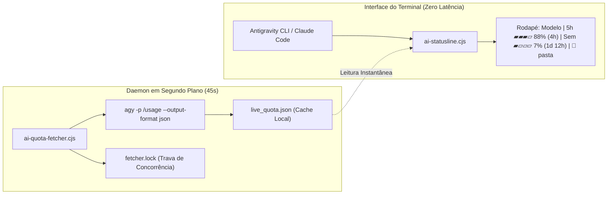

---
tags:
  - ai/opcionais
  - terminal
  - statusline
  - telemetria
  - antigravity-cli
  - claude-code
categoria: Opcionais
nome: ai-statusline
local: "~/.local/bin/ai-statusline.cjs"
updated_at: "2026-11-08T02:20:00-03:00"
---

# Statusline Pessoal & Monitor de Cotas (Antigravity & Claude Code)

> [!NOTE] **Barra Minimalista Não Bloqueante**  
> Customização de statusline de alta performance projetada para exibir em tempo real no rodapé do terminal o modelo de IA ativo, branch Git atual, uso de contexto e as cotas periódicas com barra visual de preenchimento (`▰▰▰▱▱`) e contagem regressiva para renovação.

---

## Como Funciona a Arquitetura Assíncrona

Para que o terminal nunca trave nem apresente lentidão enquanto você digita ou o agente responde, a barra adota uma arquitetura desacoplada em dois processos:



1. **`ai-statusline.cjs` (Renderizador de Tela):**
   * Executa em milissegundos a cada interação.
   * Não dispara chamadas de rede ou subprocessos lentos; lê diretamente o cache atômico em `live_quota.json`.
   * Renderiza a barra com paleta de cores Catppuccin (Verde > 50%, Amarelo 20%-50%, Vermelho < 20%).
2. **`ai-quota-fetcher.cjs` (Atualizador Silencioso):**
   * Executa em segundo plano com intervalo de segurança (45s).
   * Possui trava de arquivo (`fetcher.lock`) impedindo que múltiplos terminais abertos sobrecarreguem a CLI com chamadas concorrentes.
   * Consulta o endpoint interno do Antigravity CLI e atualiza o JSON local.

---

## Arquivos e Localização no Sistema

* **Scripts Ativos no Sistema:** `~/.local/bin/`
  * `ai-statusline.cjs` e `ai-statusline.js` *(renderizador principal)*
  * `ai-quota-fetcher.cjs` e `ai-quota-fetcher.js` *(atualizador em background)*
* **Backup Versionado no Repositório:** `toolkits/statusline/` (em `~/.minerva/toolkits/statusline`)
* **Arquivos de Dados Locais:** `~/.gemini/antigravity-cli/`
  * `live_quota.json` *(cache com métricas e cotas)*
  * `fetcher.lock` *(controle de concorrência)*

---

## Integração nas Configurações (settings.json)

Ambas as ferramentas estão configuradas para carregar o script automaticamente:

### 1. Antigravity CLI (`~/.gemini/antigravity-cli/settings.json`)
```json
{
  "statusline": {
    "command": "node ~/.local/bin/ai-statusline.cjs"
  }
}
```

### 2. Claude Code (`~/.claude/settings.json`)
```json
{
  "statusLineCommand": "node ~/.local/bin/ai-statusline.cjs"
}
```

---

## Mecanismo de Auto-Cura e Resolução de Problemas

> [!IMPORTANT] **Comportamento do Circuito de Segurança (Circuit Breaker)**  
> Se a statusline detectar 30 falhas consecutivas dentro de uma mesma sessão do terminal (por exemplo, durante a edição de código ou se o Node.js for temporariamente interrompido), o script desativa a renderização automaticamente para não poluir o terminal nem travar o fluxo de trabalho.

### Como reiniciar a barra se ela sumir:
* **Solução:** Basta **fechar e abrir novamente a aba ou janela do terminal**.  
* A nova sessão reinicia o contador de tentativas do zero e a barra reaparece instantaneamente no rodapé com os dados normalizados.
