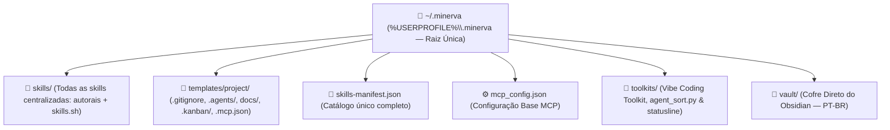
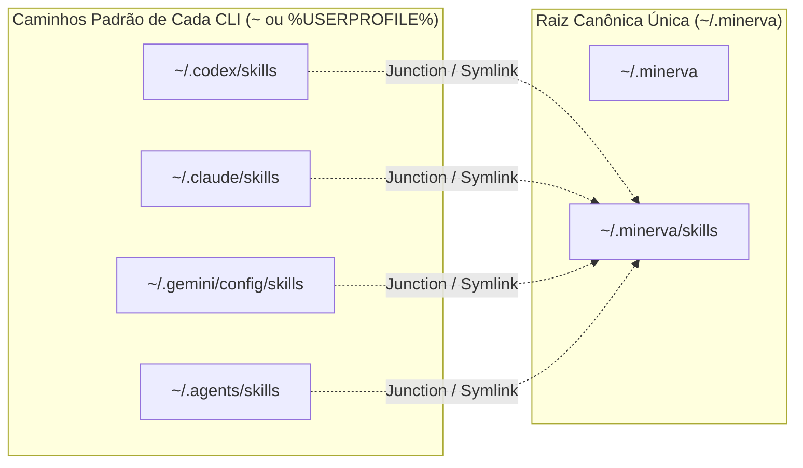

---
tags:
  - ai/arquitetura
  - documentacao
  - infraestrutura
  - ecossistema
updated_at: "2026-11-14T12:00:00Z"
---

# Arquitetura, Conceito & Raiz Global `~/.minerva`

> [!NOTE] **Objetivo Deste Documento**  
> Registrar a visão técnica, a centralização na raiz única **`~/.minerva`**, os links simbólicos (NTFS Junctions / symlinks) sem duplicação de skills, a migração automática de skills antigas no setup e a ativação completa do **`/minerva`** por projeto.

---

## 1. A Ideia & Motivação

Historicamente, cada ferramenta de IA instalada (**Codex**, **Claude Code**, **Antigravity**, **Gemini CLI**) cria diretórios separados no perfil de usuário (`~/.codex`, `~/.claude`, `~/.gemini/config`, `~/.agents`).

Essa abordagem fragmentada causa três problemas:
1. **Duplicação de Skills:** precisar baixar e atualizar skills separadamente em cada ferramenta ou projeto.
2. **Saturação de Contexto & Tokens:** despejar logs extensos do terminal ou injetar todas as skills de uma vez na sessão.
3. **Setup Repetitivo em Novos Projetos:** ter que colar prompts gigantes ou recriar `.gitignore`, `.agents/`, `docs/`, Kanban e painéis manualmente toda vez.

### A Solução Adotada (`~/.minerva` Global + `/minerva` Local)
1. **Raiz Global Única (`~/.minerva`):** centraliza **todas** as skills do ecossistema (`skills/`), `skills-manifest.json`, `mcp_config.json`, `templates/project/`, `toolkits/` e este cofre `vault/` no Obsidian. No setup (`setup.ps1` / `setup.sh`), skills preexistentes em outros caminhos são migradas para `~/.minerva/skills/` sem duplicar.
2. **Bootstrap por Projeto (`/minerva`):** ao entrar em um repositório e rodar `/minerva`, ele executa o setup completo do projeto (`.gitignore`, `.agents/`, `docs/`, `ai-memory`, `.kanban/board.json`, Painel `:3333` + Kanban `:3334`, Portais do Maestri, `context-mode` e hook local do `rtk`).

---

## 2. Topologia do Repositório



---

## 3. NTFS Junctions & Symlinks (Ponte Transparente no SO)

Para que **Claude Code, Codex, Antigravity, Gemini CLI e `npx skills`** enxerguem exatamente a mesma pasta `~/.minerva/skills/` sem cópias paralelas:



---

## 4. Protocolo MCP & Isolamento de Memória (`ai-memory`)

1. **Execução via Stdio MCP:** o `ai-memory` inspeciona a raiz Git atual (`git rev-parse --show-toplevel`) ou diretório de trabalho (`cwd`).
2. **Isolamento por Repositório:** decisões gravadas no `Projeto-A` nunca contaminam consultas no `Projeto-B`.
3. **Economia de Contexto no Projeto (`context-mode`):** inserido pelo `/minerva` no `.mcp.json` do workspace via `npx -y context-mode`, executando comandos e inspeções extensas em sandbox (`ctx_execute`, `ctx_search`).

---

## 5. Estrutura Enxuta do Cofre no Obsidian (`~/.minerva/vault/`)

```text
vault/
├── 📄 _Hub de Skills & MCPs.md
├── 📄 _Arquitetura e Documentação do Ecossistema.md
├── 📄 _Guia de Replicação em Novo PC.md
├── 📄 _Créditos e Atribuições.md
├── 📁 Workspace/      (Orquestração Minerva, Conselho dos 5 & Team CODES)
├── 📁 Skills/         (Notas resumidas PT-BR incluindo painel-agents & kanban-agents + 7 Hubs)
├── 📁 MCP/            (ai-memory, agent-desktop, rea, magicpath)
├── 📁 MODS/           (vibe-coding-toolkit & ai-statusline)
└── 📁 Frameworks/     (alethe-agents, claude-cookbooks, openwork, etc.)
```

---

## 6. Economia de Sessão: Todas no Disco, Só o Necessário no Contexto (`DAILY vs LIBRARY`)

* Todas as **191 skills** ficam instaladas em um único lugar no PC (`~/.minerva/skills/`), prontas para qualquer tecnologia.
* Dentro de um projeto grande, o `/minerva` e o `toolkits/agent_sort.py` selecionam apenas o conjunto ativo (**DAILY**, ~4 a 8 skills da stack do projeto) enquanto as demais ficam na biblioteca (**LIBRARY**) para uso sob demanda — evitando exceder o *token budget* das IDEs.
